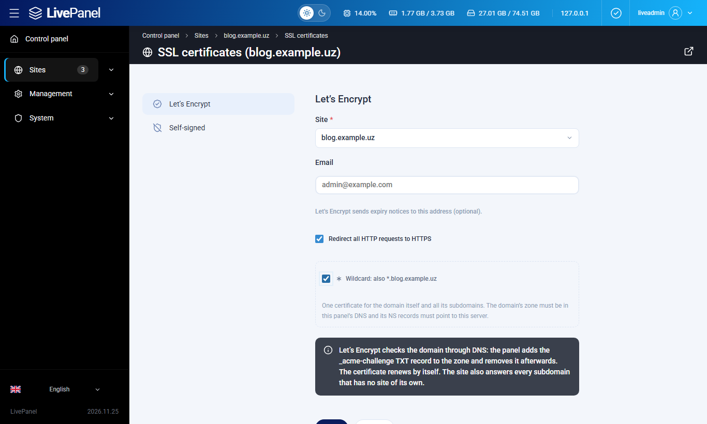

# SSL-сертификаты

SSL-сертификат шифрует трафик между сайтом и браузером, и сайт открывается по `https://`. Панель получает бесплатный сертификат **Let’s Encrypt** в один клик и продлевает его до окончания срока.

## Получение сертификата

1. Домен (и псевдоним `www`) должен **указывать на IP-адрес этого сервера**. Изменения DNS расходятся от нескольких минут до нескольких часов.
2. Откройте плитку **«SSL-сертификаты»** на странице сайта.
3. Нажмите **«Новый сертификат»**.
4. Выберите сайт и тип:
   - **Let’s Encrypt** — доверенный, бесплатный, на 90 дней; панель продлевает его сама.
   - **Самоподписанный** — шифрует трафик, но браузеры предупреждают. Для тестовых сайтов, домен которых ещё не указывает сюда.
5. **Email** необязателен: Let’s Encrypt пишет туда о проблемах со сроком.
6. Включите **«Перенаправлять все HTTP-запросы на HTTPS»**.
7. Подтвердите. Сертификат устанавливается за несколько секунд.

Сертификат покрывает домен сайта и все его псевдонимы.

## Список сертификатов

В таблице — сайт, тип, срок действия и перенаправление на HTTPS. В меню строки:

- **«Перевыпустить»** — получить сертификат заново (например, после добавления псевдонима);
- включение и выключение **перенаправления на HTTPS**;
- **«Удалить сертификат»** — сайт работает только по HTTP.

## Wildcard-сертификат (Premium)

Wildcard-сертификат — один сертификат для самого домена и **всех его поддоменов**: `example.uz` и `*.example.uz`. Доступен только в панелях с лицензией **Premium**.

Условия:

- DNS-зона домена должна быть в этой панели — [Домены и DNS](dns.md);
- у регистратора NS-серверы домена должны указывать на этот сервер (`dig NS example.uz`).

Как получить: **Новый сертификат** → **Let’s Encrypt** → отметьте **Wildcard: также \*.домен**. Let’s Encrypt проверяет домен через DNS. Панель сама добавляет TXT-запись `_acme-challenge` в зону и удаляет её после проверки. Сертификат продлевается автоматически тем же способом.

Сайт с wildcard-сертификатом отвечает и на все поддомены, у которых нет своего сайта (в `server_name` добавляется `*.домен`). Поддомены со своим сайтом открывают свой сайт, как и раньше.

Ошибки:

- **нет зоны** — сначала создайте зону в разделе **Домены и DNS**;
- **NS не указывают на этот сервер** — смените NS у регистратора и дождитесь обновления.

## Автоматическое продление

Сертификаты Let’s Encrypt продлеваются сами до окончания срока. Если до конца осталось меньше 14 дней, а продление не прошло, панель пишет владельцу сайта и администратору.

## Если сертификат не выдаётся

- **Домен указывает в другое место** — проверьте A-запись: `nslookup example.uz`.
- **Закрыт порт 80** — Let’s Encrypt проверяет через порт 80. В файрволе должно остаться правило HTTP — [Файрвол](firewall.md).
- **Включён прокси Cloudflare (оранжевое облако)** — выключите его на время или поставьте в Cloudflare режим SSL «Full».
- **Слишком много попыток** — Let’s Encrypt ограничивает попытки на домен; повторите через час.

SSL для самой панели — [Адрес панели и SSL](panel-access.md).
