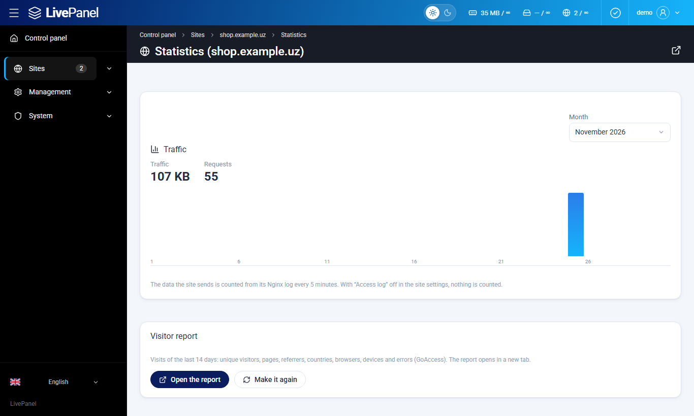
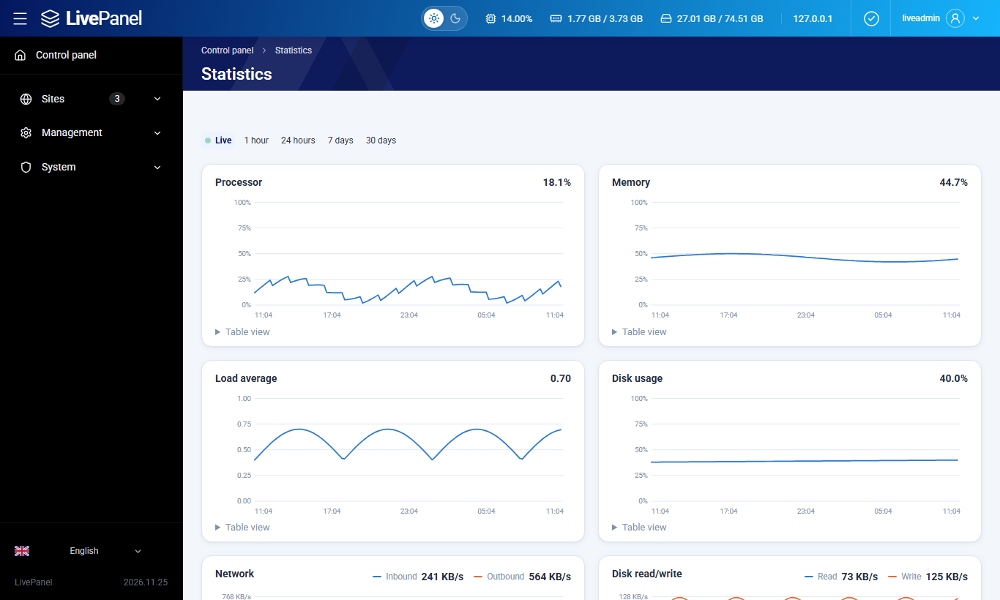

# Статистика и трафик

## Статистика сайта

Плитка **«Статистика»** на странице сайта показывает:

- **Трафик** — объём отданных сайтом данных и число запросов за выбранный месяц;
- **график по дням** — наведите на столбец дня, чтобы увидеть дату, объём и число запросов;
- выбор **месяца** — текущий и 11 предыдущих.

Трафик считается по журналу доступа Nginx сайта каждые 5 минут и хранится 400 дней. Если в настройках сайта выключен **журнал доступа**, трафик не считается.

### Отчёт о посещениях

**«Открыть отчёт»** открывает в новой вкладке подробный отчёт (GoAccess) о посещениях за последние 14 дней:

- уникальные посетители и запросы по дням;
- самые посещаемые страницы и файлы, ненайденные страницы (404);
- откуда пришли посетители (источники), страны;
- браузеры, операционные системы, устройства и боты;
- коды ответа и файлы с наибольшим трафиком.

Отчёт кэшируется на 10 минут; **«Построить заново»** сразу пересобирает его. IP-адреса посетителей в отчёте анонимизируются.

## Статистика сервера

**Система → Статистика** (для администратора) показывает нагрузку сервера на графиках:

- процессор, память, занятость диска и средняя нагрузка (load average);
- сеть (входящий/исходящий) и скорость чтения/записи диска.

Периоды: **В реальном времени** (обновление каждые 2 секунды), **1 час**, **24 часа**, **7 дней**, **30 дней**. Каждый график можно показать и таблицей.

## Трафик аккаунтов и сайтов

Внизу этой же страницы — раздел **«Трафик: аккаунты и сайты»**: трафик и запросы каждого аккаунта (сумма всех его сайтов) и каждого сайта за выбранный месяц, с общим графиком по дням. Удобно, чтобы следить, сколько трафика расходуют клиенты.
