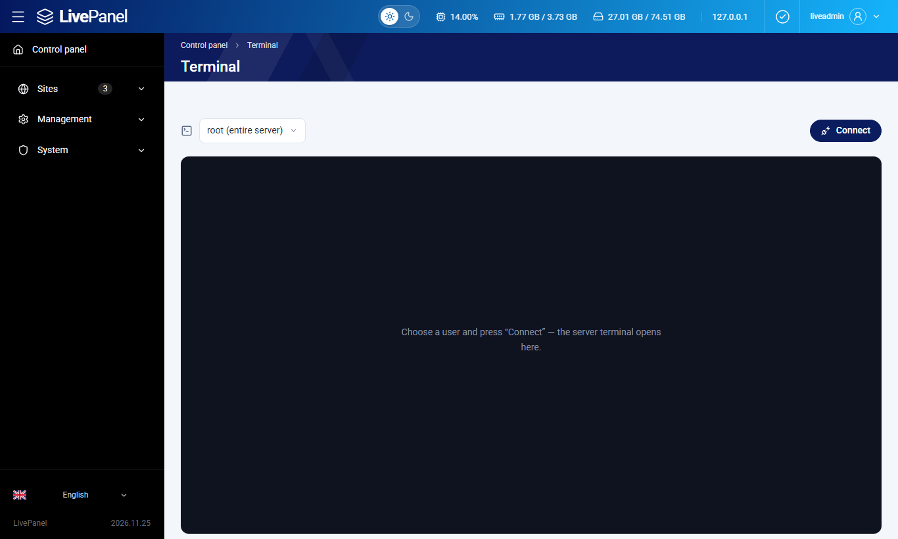

# Терминал

**Система → Терминал** открывает терминал сервера прямо в браузере — программа SSH не нужна.

1. Выберите пользователя:
   - **root (весь сервер)** — только для администратора; команды влияют на весь сервер;
   - пользователь сайта — терминал открывается в той же защищённой среде, что и SSH: видна только его домашняя папка.
2. Нажмите **«Подключиться»**.

В терминале работают обычные команды: `ls`, `cd`, `nano`, `git`, `composer`, `npm`, `php`, `.venv/bin/pip` в папке сайта и т. д. После 30 минут бездействия сессия закрывается; **«Переподключиться»** открывает новую.

Обычный пользователь может пользоваться терминалом, только если у него есть доступ по SSH — администратор включает его в разделе **«Пользователи»** ([Пользователи, роли и лимиты](users.md)).
