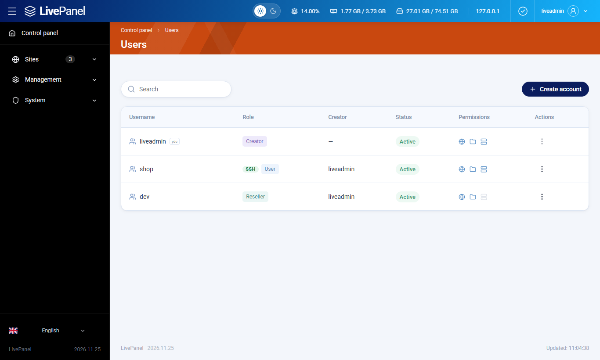
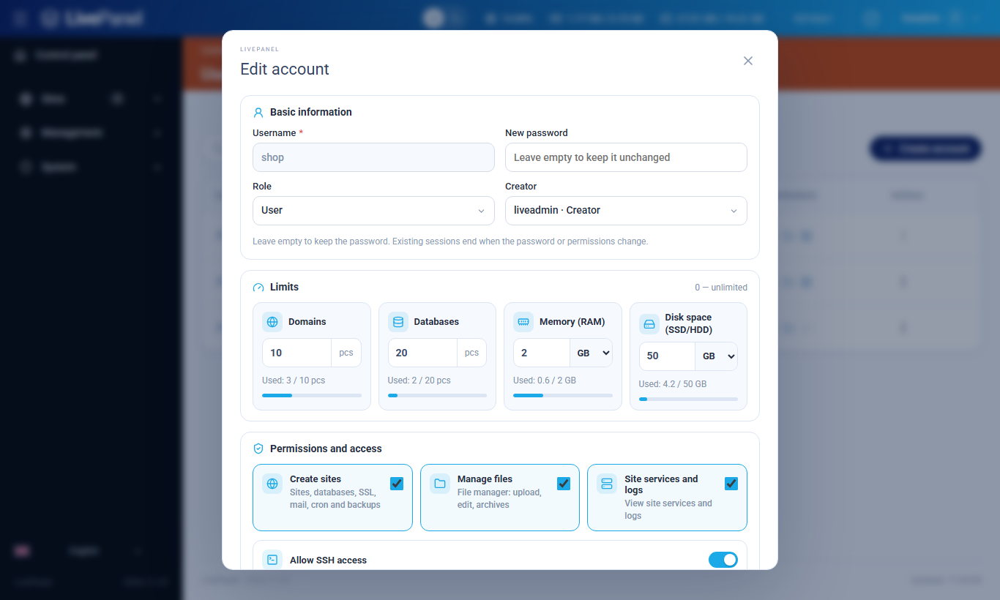

# Пользователи, роли и лимиты

В разделе **Система → Пользователи** создаются и управляются аккаунты панели. Если дать каждому клиенту отдельный аккаунт, он будет видеть и управлять только своими сайтами.

## Роли

| Роль | Возможности |
|---|---|
| **Creator** | Главный администратор, созданный установщиком (`liveadmin`). Доступ ко всему; удалить нельзя |
| **Admin** | Управляет всем сервером и всеми аккаунтами |
| **Reseller** | Управляет созданными им пользователями и выдаёт им лимиты; может задать свой бренд |
| **Пользователь** | Работает только со своими сайтами; настроек сервера не видит |

## Создание аккаунта

1. Нажмите **«Создать аккаунт»**.
2. **Основные данные**: логин, пароль, роль и (для администратора) какому аккаунту он подчиняется.
3. **Ограничения** (на тарифах Pro и Premium; 0 — без ограничений):

   | Лимит | Значение |
   |---|---|
   | Домены | Сколько сайтов можно создать |
   | Базы | Число баз данных |
   | Оперативная память (RAM) | Сколько RAM могут занимать все сайты вместе (не менее 32 МБ) |
   | Место на диске | Диск для файлов сайтов, загрузок и почты |
   | Пользователи | Сколько пользователей может создать реселлер |

4. **Права и доступ**:
   - **Создание сайтов** — сайты, базы, SSL, почта, cron и резервные копии;
   - **Управление файлами** — файловый менеджер: загрузка, редактирование, архивы;
   - **Службы и логи сайтов** — просмотр служб и логов;
   - **Разрешить вход по SSH** — SSH/SFTP с паролем панели; пользователь видит только свою папку.
5. Сохраните.

## Управление аккаунтами

В меню строки: изменить, сменить пароль, **выключить 2FA** (для пользователя, потерявшего телефон) и удалить. Если выключить **«Аккаунт активен»**, пользователь не сможет войти в панель.

## Как работают лимиты

- Когда лимит **доменов или баз** достигнут, новый сайт или база не создаётся.
- Лимит **диска** работает через дисковые квоты Linux. Если квоты выключены, панель показывает кнопку **«Включить квоты»** (только для файловой системы ext4; копия старого `/etc/fstab` сохраняется).
- Лимит **RAM**: когда сайты аккаунта достигают 90% лимита, аккаунт **блокируется**, а его сайты отключаются (файлы и базы сохраняются). В списке появляется метка «RAM-блок», администратору приходит письмо. Чтобы снять блок, откройте аккаунт, включите **«Аккаунт активен»** и сохраните — сайты включатся снова.

Пользователь видит свои лимиты и их использование в верхней панели.

## Реселлеры и брендинг

Реселлер выдаёт созданным пользователям лимиты в пределах своих. В **Настройки → Брендинг** реселлер задаёт название, логотип и цвет панели — его клиенты видят панель с этим брендом ([Настройки и безопасность панели](panel-settings.md)).
