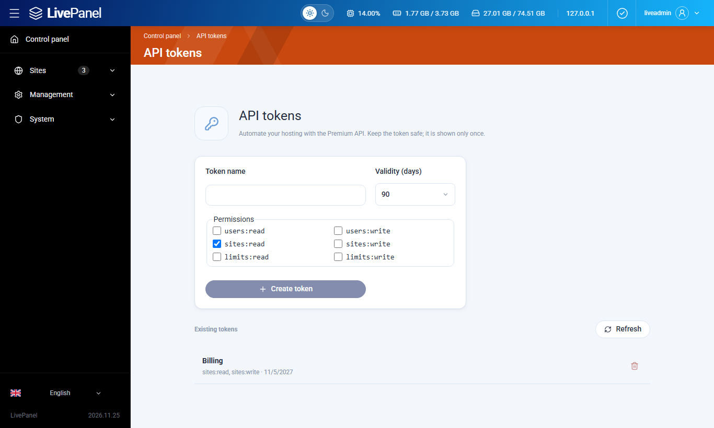

# API tokenlar va amallar tarixi

## API tokenlar (Premium)

**Premium** tarifda hosting xizmatlarini API orqali avtomatlashtirish mumkin: masalan, billing tizimingiz to‘lovdan keyin mijozga akkaunt va sayt yaratadi va uning limitlarini belgilaydi.

### Token yaratish

1. **Tizim → API tokenlar** sahifasini oching.
2. **Token nomi** — masalan «Billing».
3. **Amal qilish muddati (kun)**.
4. **Ruxsatlar** — har bir bo‘lim uchun **O‘qish** va **Yozish**: saytlar, fayllar, bazalar, DNS, pochta, FTP, cron, zaxira, Git, akkauntlar, limitlar, brending va server. **«Hammasini o‘qish»** va **«To‘liq kirish»** tugmalari tez belgilaydi. Ro‘yxatda faqat akkauntingizga ruxsat etilgan bo‘limlar chiqadi; batafsil — [API v2 ma’lumotnomasi](api-reference.md#ruxsatlar-scopes).
5. **«Token yaratish»** ni bosing. **Tokenni darhol nusxalab oling** — u faqat bir marta ko‘rsatiladi.

So‘rovlarda token `Authorization: Bearer <token>` sarlavhasida yuboriladi; barcha endpointlar va misollar — [API ma’lumotnomasi](api-reference.md). **Mavjud tokenlar** ro‘yxatidan keraksiz tokenni **bekor qilasiz** — u darhol ishlamay qoladi.

> Tokenni ruxsat etilgan eng kam huquqlar bilan yarating va maxfiy saqlang: u panel paroli kabi kuchga ega.

## Amallar tarixi

**Tizim → Amallar tarixi** panelda kim, qachon va nima qilganini ko‘rsatadi: sayt yaratish va o‘chirish, bazalar, fayl yuklash, zaxira, Git deploy, firewall o‘zgarishlari, kirishlar va boshqalar. Har bir yozuvda foydalanuvchi (yoki `webhook`), amal va vaqt bor.

Administrator barcha akkauntlarning amallarini, reseller esa o‘z foydalanuvchilarinikini ko‘radi. Saytda nima o‘zgargani noma’lum bo‘lsa yoki fayl kim tomonidan o‘chirilganini bilish kerak bo‘lsa — birinchi shu yerga qarang.
