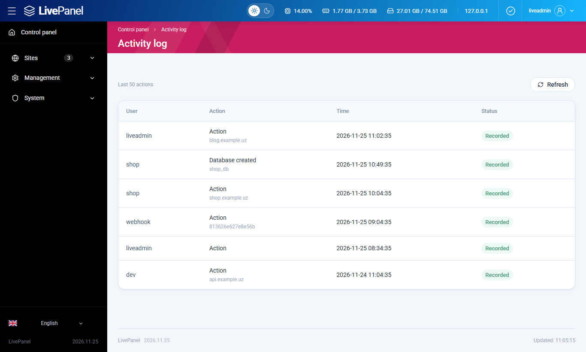

# API tokenlar va amallar tarixi

## API tokenlar (Premium)

**Premium** tarifda hosting xizmatlarini API orqali avtomatlashtirish mumkin: masalan, billing tizimingiz to‘lovdan keyin mijozga akkaunt va sayt yaratadi, limitlarini o‘zgartiradi yoki muddati tugaganda bloklaydi.

### Token yaratish

1. **Tizim → API tokenlar** sahifasini oching.
2. **Token nomi** — masalan «Billing».
3. **Amal qilish muddati (kun)**.
4. **Ruxsatlar** — token faqat belgilangan amallarni bajara oladi:

   | Ruxsat | Nima qiladi |
   |---|---|
   | `users:read` / `users:write` | Akkauntlarni ko‘rish / yaratish, o‘zgartirish |
   | `sites:read` / `sites:write` | Saytlarni ko‘rish / yaratish, o‘zgartirish |
   | `limits:read` / `limits:write` | Limitlarni ko‘rish / o‘zgartirish |

5. **«Token yaratish»** ni bosing. **Tokenni darhol nusxalab oling** — u faqat bir marta ko‘rsatiladi.

So‘rovlarda token `Authorization: Bearer <token>` sarlavhasida yuboriladi. **Mavjud tokenlar** ro‘yxatidan keraksiz tokenni **bekor qilasiz** — u darhol ishlamay qoladi.

> Tokenni ruxsat etilgan eng kam huquqlar bilan yarating va maxfiy saqlang: u panel paroli kabi kuchga ega.

## Amallar tarixi

**Tizim → Amallar tarixi** panelda kim, qachon va nima qilganini ko‘rsatadi: sayt yaratish va o‘chirish, bazalar, fayl yuklash, zaxira, Git deploy, firewall o‘zgarishlari, kirishlar va boshqalar. Har bir yozuvda foydalanuvchi (yoki `webhook`), amal va vaqt bor.

Administrator barcha akkauntlarning amallarini, reseller esa o‘z foydalanuvchilarinikini ko‘radi. Saytda nima o‘zgargani noma’lum bo‘lsa yoki fayl kim tomonidan o‘chirilganini bilish kerak bo‘lsa — birinchi shu yerga qarang.
