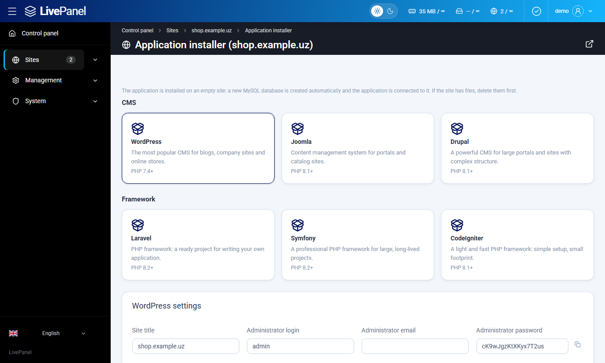

# CMS va frameworklarni o‘rnatish

Panel mashhur CMS va frameworklarni bir bosishda o‘rnatadi: yuklab oladi, kerak bo‘lsa ma’lumotlar bazasini yaratadi, sozlaydi va ishga tushiradi. Ilovani ikki joydan o‘rnatish mumkin:

- **Sayt yaratish ustasi → CMS / Framework** — sayt va ilova birga yaratiladi ([Sayt yaratish](create-site.md));
- mavjud bo‘sh saytda **«Ilova o‘rnatish»** plitkasi.

## Ilovalar ro‘yxati

| Platforma | CMS | Frameworklar |
|---|---|---|
| **PHP** | WordPress (PHP 7.4+), Joomla (8.1+), Drupal (8.1+) | Laravel (8.2+), Symfony (8.2+), CodeIgniter (8.1+) |
| **Node.js** | Strapi (Node.js 20+), Ghost (22+) | Express (18+), Next.js (20+), NestJS (20+) |
| **Python** | Wagtail (Python 3.11+) | Django, Flask, FastAPI (3.11+) |

Ilova saytning turiga mos bo‘lishi kerak: PHP ilovasi PHP saytga, Node.js ilovasi Node.js saytga va hokazo. Saytning PHP/Node.js/Python versiyasi eski bo‘lsa, panel ogohlantiradi — versiyani [sayt sozlamalarida](site-settings.md) ko‘taring.

## O‘rnatish

1. Sayt **bo‘sh** bo‘lishi kerak (faqat panelning boshlang‘ich sahifasi). Saytda fayllar bo‘lsa, avval ularni o‘chiring yoki yangi sayt yarating.
2. **«Ilova o‘rnatish»** plitkasini oching va ilovani tanlang.
3. Administrator so‘raladigan ilovalarda (WordPress, Joomla, Drupal, Wagtail, Django) to‘ldiring:
   - **Sayt nomi**;
   - **Administrator logini**, **emaili** va **paroli** (kamida 12 belgi; panel tayyor parol taklif qiladi).
4. **«… ni o‘rnatish»** tugmasini bosing.

O‘rnatish jarayoni bosqichma-bosqich ko‘rinadi (baza yaratish, yuklab olish, sozlash, o‘rnatish, ishga tushirish). Bu bir necha daqiqa davom etishi mumkin; sahifani yopsangiz ham o‘rnatish davom etadi.

## Natija

O‘rnatish tugagach:

- sayt manzili va **administrator paneli** havolasi (masalan WordPress uchun `/wp-admin/`, Django va Wagtail uchun `/admin/`, FastAPI uchun `/docs`);
- yaratilgan **baza nomi, foydalanuvchisi va paroli** — saqlab qo‘ying.

Xato bo‘lsa, sababi va jarayon logi ko‘rsatiladi; sayt boshlang‘ich holatiga qaytariladi va **«Yangi o‘rnatish»** bilan qayta urinish mumkin.

## Platformalar bo‘yicha

- **PHP CMS** — fayllar sayt papkasiga yuklanadi va yangi MySQL bazaga ulanadi. WordPress WP-CLI orqali o‘rnatiladi.
- **PHP frameworklar** — Composer bilan loyiha yaratiladi; saytning web ildizi loyihaning `public/` papkasi bo‘ladi.
- **Node.js** — loyiha sayt papkasiga yaratiladi, kerak bo‘lsa yig‘iladi (`npm run build`) va sayt xizmati uni ishga tushiradi. Strapi va Ghost MySQL bazasini oladi.
- **Python** — loyiha sayt papkasida yaratiladi, paketlar saytning `.venv` muhitiga o‘rnatiladi va Gunicorn uni ishga tushiradi. Django va Wagtail ma’lumotlarni SQLite faylida saqlaydi, statik fayllarni WhiteNoise beradi.

Python va Node.js loyihalarini keyin qanday boshqarish — [Python va Node.js saytlar](python-nodejs.md).
