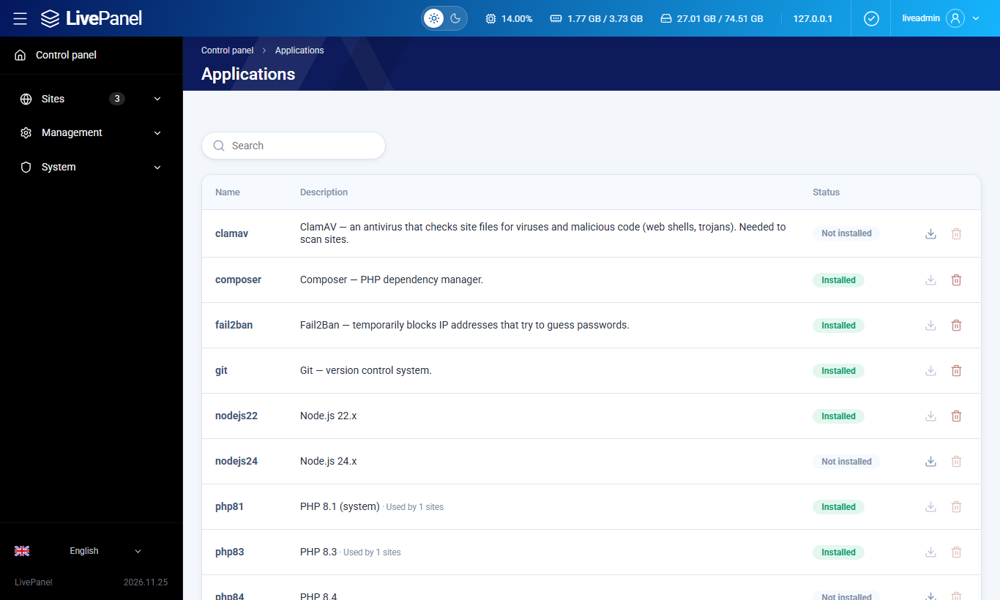

# Ilovalar (server dasturlari)

**Tizim → Ilovalar** (administrator uchun) serverga qo‘shimcha dasturlarni o‘rnatish va o‘chirish joyi. Har bir o‘rnatish fonda bajariladi; holati ro‘yxatda ko‘rinadi.

## Nimalar bor

| Guruh | Ilovalar |
|---|---|
| PHP | PHP 5.6 – 8.6 (har bir versiya FPM, CGI, CLI va asosiy kengaytmalar bilan). tizim versiyasi Ubuntu 22.04’da PHP 8.1, Ubuntu 24.04’da PHP 8.3 |
| Node.js | Node.js 16 – 26 (rasmiy nodejs.org yig‘malari, sha256 bilan tekshiriladi) |
| Python | Python 3.11 – 3.15 (python-build-standalone, sha256 bilan tekshiriladi) |
| Xizmatlar | Redis, Memcached, fail2ban, BIND (DNS), SpamAssassin, ClamAV, Roundcube webmail |
| Bazalar | PostgreSQL, phpMyAdmin (tizim qismi) |
| Asboblar | Git, Composer, WP-CLI, jpegoptim, optipng, AWStats, ttyd |

## O‘rnatish va o‘chirish

- **O‘rnatish** belgisi ilovani o‘rnatadi. Jarayon bir necha daqiqa olishi mumkin; holat **«O‘rnatilmoqda»** dan **«O‘rnatilgan»** ga o‘tadi.
- **O‘chirish** belgisi ilovani olib tashlaydi.
- Tizim qismlari (masalan tizim PHP’si, phpMyAdmin) o‘chirilmaydi.
- Saytlar ishlatayotgan versiyani o‘chirib bo‘lmaydi — ro‘yxatda «N ta sayt ishlatyapti» deb ko‘rsatiladi. Avval saytlarni boshqa versiyaga o‘tkazing.
- Xato bo‘lsa, holat **«Xato»** bo‘ladi va sababi ko‘rsatiladi.

## Qachon nima kerak

| Vazifa | O‘rnating |
|---|---|
| Python sayt yaratish | Python 3.x |
| Saytni yangi PHP’ga o‘tkazish | PHP 8.x |
| Saytlarni virusga tekshirish | ClamAV |
| SSH, FTP, pochtani parol tanlashdan himoya | fail2ban |
| Shu serverni DNS server qilish | BIND |
| Pochtani brauzerdan ochish | Roundcube |
| PostgreSQL bazalar | PostgreSQL |
| Keshlash (WordPress, Laravel) | Redis yoki Memcached |
