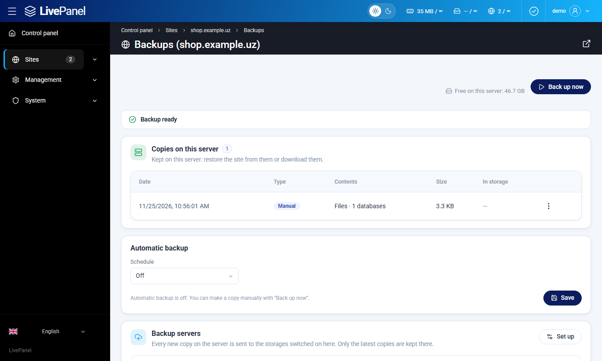
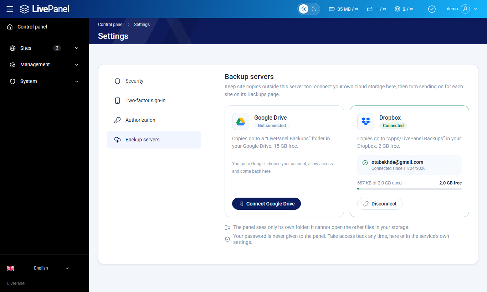

# Zaxira nusxalar

Panel saytning fayllari va ma’lumotlar bazalarini zaxiraga oladi, jadval bo‘yicha avtomatik nusxa yaratadi, bir bosishda tiklaydi va nusxalarni **Google Drive** yoki **Dropbox**’ga ham yuboradi.

Sayt sahifasidagi **«Zaxira nusxalar»** plitkasidan ochiladi. Yuqorida serverdagi bo‘sh joy va **«Hozir zaxiralash»** tugmasi turadi.

## Serverdagi nusxalar

Har bir nusxaning sanasi, turi (**Qo‘lda**, **Avtomatik** yoki **Ombordan**), tarkibi (fayllar, bazalar soni), hajmi va qaysi omborlarga yuborilgani ko‘rinadi. Satr menyusidan:

- **Yuklab olish** — nusxani kompyuterga `.tar` arxiv qilib saqlash;
- **Tiklash** — saytni shu nusxa holatiga qaytarish;
- **O‘chirish** — nusxa serverdan o‘chadi (omborlardagi nusxalar o‘chmaydi).

### Tiklash

1. Nusxa menyusida **«Tiklash»** ni tanlang.
2. Nimani tiklashni belgilang: **Fayllar** va/yoki **Ma’lumotlar bazalari**.
3. Tasdiqlang.

> Fayllar tiklanganda sayt papkasi to‘liq almashtiriladi — hozirgi fayllar o‘chadi. Bazalar nusxadagi holatga qaytadi.

## Avtomatik zaxira

**Avtomatik zaxira** bo‘limida:

- **Jadval** — **O‘chirilgan**, **Har kuni** yoki **Har hafta** (hafta kuni bilan);
- **Vaqti (server)** — serverdagi soat bo‘yicha;
- **Nechta nusxa saqlansin** — eski avtomatik nusxalar o‘zi o‘chiriladi (qo‘lda olinganlar va ombordan olinganlar o‘chmaydi);
- nimani zaxiralash: **Fayllar** va **Ma’lumotlar bazalari**.

Oxirgi avtomatik zaxira natijasi shu yerda ko‘rinadi.

## Zaxira serverlari (Google Drive, Dropbox)

Nusxalarning server tashqarisidagi nusxasi server buzilganda saytni tiklash imkonini beradi.

### 1. Omborni ulash

**Sozlamalar → Zaxira serverlari** bo‘limida:

- **Google Drive’ni ulash** — Google sahifasi ochiladi, akkauntni tanlab ruxsat berasiz. Google oynasida **«Google Diskdagi fayllar»** katakchasini belgilang — aks holda ulanmaydi.
- **Dropbox’ni ulash** — Dropbox sahifasida **Allow** ni bosasiz.

Panel faqat o‘zi yaratgan papkani ko‘radi (Google Drive’da «LivePanel Backups», Dropbox’da «Apps/LivePanel Backups») — boshqa fayllaringizga kira olmaydi. Parolingiz panelga berilmaydi. Har bir foydalanuvchi o‘z omborini ulaydi; kartada ombordagi band va bo‘sh joy ko‘rinadi.

### 2. Saytda yuborishni yoqish

Sayt **Zaxira nusxalar** sahifasidagi **Zaxira serverlari** bo‘limida:

1. Ombor qatoridagi kalitni yoqing.
2. **Omborda saqlanadigan nusxalar** sonini belgilang (1–60).
3. **«Hozir yuborish»** — mavjud nusxani darhol yuboradi.

Shundan keyin serverdagi har bir yangi nusxa omborga bir necha daqiqada o‘zi yuboriladi. Omborda belgilangan sondan ortiq eski nusxalar o‘chiriladi.

> «Hozir yuborish» yangi nusxa yaratmaydi, faqat serverdagi nusxalarni yuboradi. Serverda nusxa bo‘lmasa, avval **«Hozir zaxiralash»** ni bosing.

### 3. Ombordan tiklash

**Ombordagi nusxalar** jadvalida har bir nusxaning holati ko‘rinadi: **«Serverda ham bor»**, **«Faqat omborda»** yoki **«Boshqa serverdan»**. Faqat omborda bo‘lgan nusxa uchun **«Serverga olish»** tugmasi nusxani serverga qaytaradi — keyin uni odatdagidek tiklaysiz. Shu yo‘l bilan saytni **boshqa serverga ko‘chirish** ham mumkin: yangi serverda xuddi shu omborni ulab, nusxani oling.
