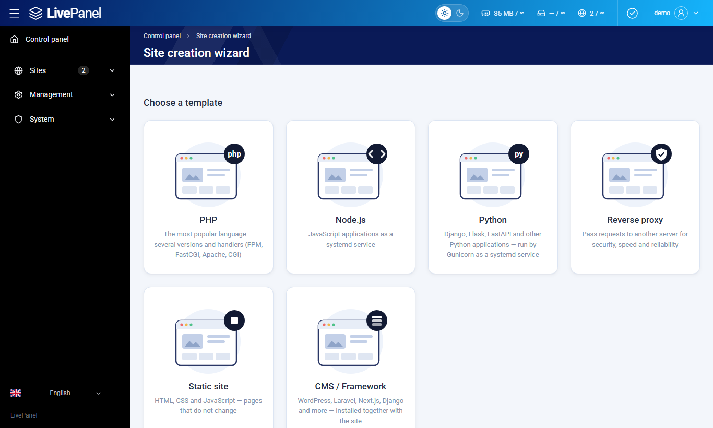
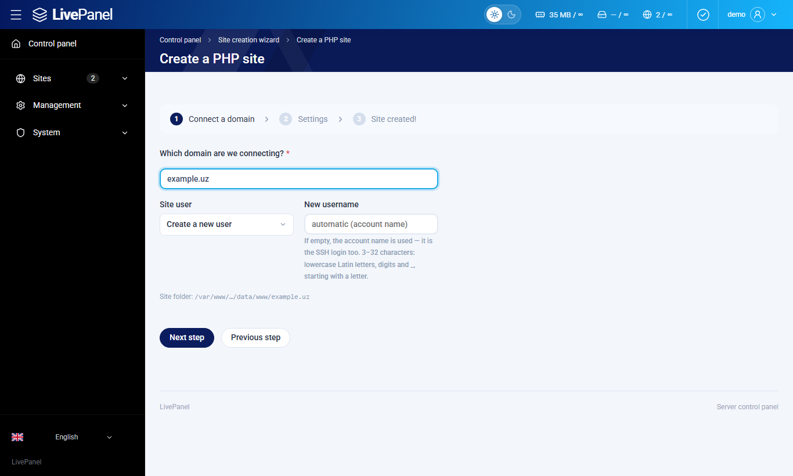
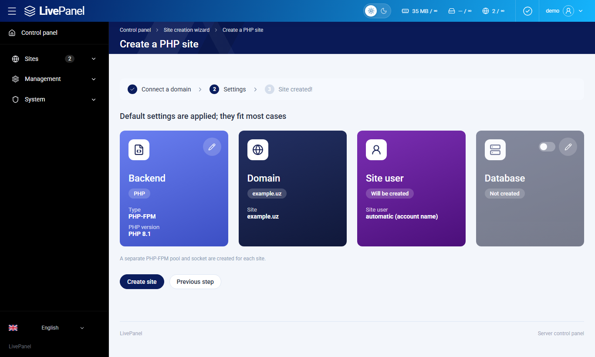

# Sayt yaratish

Sayt **«Sayt yaratish ustasi»** orqali uch qadamda yaratiladi: shablon → domen → sozlamalar. Ustani **Saytlar** sahifasidagi **«Sayt yaratish»** tugmasi ochadi.

> Domen sayt yaratilishidan oldin yoki keyin serverga yo‘naltirilishi kerak: domen registratorida yoki DNS xizmatida domenning **A yozuvini server IP manziliga** qarating. Shu server DNS server bo‘lishi ham mumkin — [Domenlar va DNS](dns.md).

## 1-qadam: shablonni tanlang

| Shablon | Qachon tanlanadi |
|---|---|
| **PHP** | WordPress, Laravel va boshqa PHP saytlar. Bir nechta PHP versiyasi va ishlov beruvchi (PHP-FPM, FastCGI, Apache, CGI) |
| **Node.js** | Express, Next.js, NestJS va boshqa JavaScript ilovalar — systemd xizmati sifatida ishlaydi |
| **Python** | Django, Flask, FastAPI va boshqa Python ilovalar — Gunicorn bilan ishlaydi |
| **Reverse proxy** | So‘rovlarni boshqa manzilga uzatish (masalan, Docker konteynerdagi ilova yoki boshqa server) |
| **Statik sayt** | Faqat HTML, CSS va JavaScript fayllar |
| **CMS / Framework** | Tayyor ilovani sayt bilan birga avtomatik o‘rnatish |

### CMS / Framework

Bu shablonda avval platforma (PHP, Node.js, Python), keyin turi (**CMS** yoki **Framework**) va ilova tanlanadi. Sayt yaratilgach ilova avtomatik yuklab olinadi va o‘rnatiladi — batafsil: [CMS va frameworklarni o‘rnatish](app-installer.md).

## 2-qadam: domenni bog‘lang

- **Qaysi domenni bog‘laymiz?** — saytning domeni, masalan `example.uz`. `www.example.uz` avtomatik alias sifatida qo‘shiladi.
- **Sayt foydalanuvchisi** — sayt qaysi Linux foydalanuvchisi nomidan ishlashi:
  - **Yangi foydalanuvchi yaratish** — har yangi sayt uchun tavsiya etiladi; saytlar bir-biridan ajratiladi.
  - **Mavjud foydalanuvchi** — sayt avvalgi saytingiz bilan bir foydalanuvchida bo‘ladi (fayllarga birgalikda kirish kerak bo‘lsa).
- **Yangi foydalanuvchi nomi** — bo‘sh qolsa, hisob nomi olinadi; bu nom SSH logini ham bo‘ladi. 3–32 belgi: kichik lotin harflari, raqamlar va `_`, harf bilan boshlanadi.
- Administrator va reseller saytni boshqa akkauntga ham yaratishi mumkin.

**Subdomenlar.** `blog.example.uz` kabi subdomen kiritilsa va `example.uz` panelda bo‘lsa, yangi sayt avtomatik shu saytning foydalanuvchisiga qo‘shiladi.

Sayt papkasi pastda ko‘rsatiladi: `/var/www/<foydalanuvchi>/data/www/<domen>`. Saytga kirish nuqtasi — shu papkaning o‘zi.

## 3-qadam: sozlamalar

Standart sozlamalar ko‘p holatlar uchun mos. Kartadagi qalam belgisi bilan o‘zgartirish mumkin:

- **Backend** — PHP versiyasi va ishlov beruvchisi, Node.js yoki Python versiyasi, proxy manzili.
- **Domen** va **Sayt foydalanuvchisi** — 2-qadamdagi tanlov.
- **Ma’lumotlar bazasi** — kalitni yoqsangiz, sayt bilan birga MySQL yoki PostgreSQL bazasi yaratiladi. Baza saytga bog‘lanadi: sayt o‘chirilsa, baza ham o‘chadi.

**«Sayt yaratish»** tugmasini bosing. Bir necha soniyada sayt ishga tushadi va papkada boshlang‘ich sahifa turadi — uni o‘z faylingiz bilan almashtirasiz.

## Saytdan keyin

1. [SSL sertifikat oling](ssl.md) — bir bosishda bepul Let’s Encrypt.
2. Fayllarni [fayl menejeri](file-manager.md), [FTP/SFTP](ftp-ssh.md) yoki [Git](git-deploy.md) orqali yuklang.
3. Kerak bo‘lsa [baza](databases.md) va [pochta](mail.md) yarating.
4. [Avtomatik zaxirani](backups.md) yoqing.

> Python sayt uchun avval serverga Python versiyasini o‘rnatish kerak (**Tizim → Ilovalar**). O‘rnatilmagan bo‘lsa, usta ogohlantiradi va «Sayt yaratish» tugmasi o‘chib turadi.
