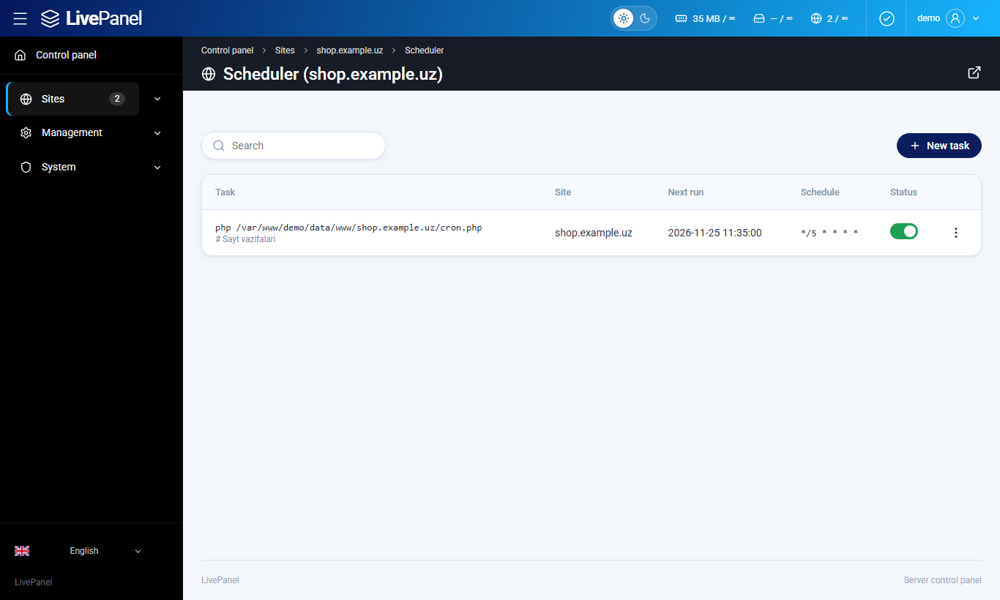

# Rejalashtiruvchi (cron)

Rejalashtiruvchi buyruqlarni jadval bo‘yicha avtomatik ishga tushiradi: masalan, har 5 daqiqada saytning `cron.php` fayli, har kuni hisobot yuborish yoki keshni tozalash.



Sayt sahifasidagi **«Rejalashtiruvchi»** plitkasini oching. Jadvalda har bir vazifaning buyrug‘i, sayti, **keyingi ishga tushish** vaqti, jadvali va holati ko‘rinadi.

## Vazifa qo‘shish

1. **«Yangi vazifa»** tugmasini bosing.
2. **Sayt** — vazifa shu saytning foydalanuvchisi nomidan ishlaydi.
3. **Jadval** — tayyor variantlardan birini tanlang: **Har daqiqa**, **Har soatda**, **Har kuni**, **Har hafta**, **Har oy** yoki **Maxsus**. Maxsusda daqiqa, soat, kun, oy va hafta kunini alohida kiritasiz; pastda tayyor **cron ifodasi** ko‘rinadi (masalan `*/5 * * * *`).
4. **Buyruq** — bajariladigan buyruq. To‘liq yo‘llarni yozing:

   ```bash
   php /var/www/shop/data/www/shop.example.uz/cron.php
   ```

   PHP saytlarda saytning PHP versiyasini aniq ko‘rsatish uchun `/usr/bin/php8.3` kabi yo‘ldan foydalaning.
5. **Izoh** — vazifa nima uchun ekanini eslatma sifatida yozing.
6. Saqlang.

## Vazifani boshqarish

- **Yoqish/o‘chirish** kaliti — vazifani o‘chirmasdan to‘xtatib turish.
- **Hozir ishga tushirish** — buyruqni darhol bajaradi va natijasini ko‘rsatadi: chiqish kodi, bajarilish vaqti va buyruq chiqargan matn. Vazifani sinash uchun qulay.
- **Tahrirlash** va **O‘chirish**.

## Maslahatlar

- Laravel uchun: `php /var/www/<foydalanuvchi>/data/www/<domen>/artisan schedule:run` — har daqiqa.
- WordPress uchun avval `wp-config.php` ga `define('DISABLE_WP_CRON', true);` qo‘shing, keyin `php .../wp-cron.php` ni har 5 daqiqada ishga tushiring.
- Buyruq chiqargan matn saqlanmaydi; log kerak bo‘lsa, uni faylga yo‘naltiring: `... >> /var/www/<foydalanuvchi>/data/cron.log 2>&1`.
