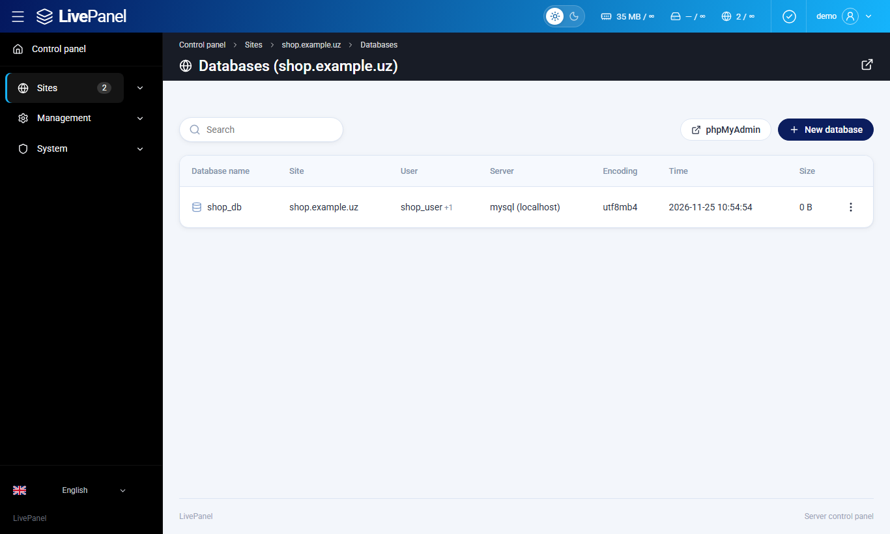
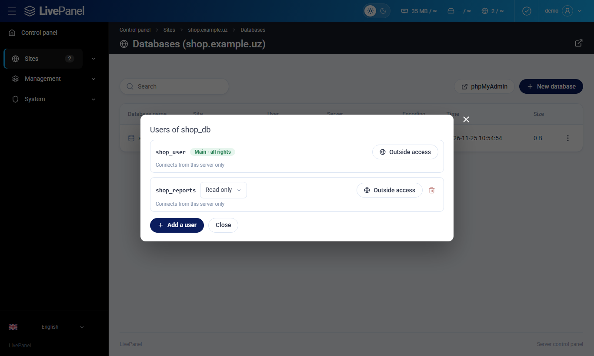

# Ma’lumotlar bazalari

Panel **MySQL 8** (o‘rnatish bilan birga keladi) va **PostgreSQL** (**Tizim → Ilovalar** dan o‘rnatiladi) bazalarini boshqaradi. Har bir baza bitta saytga bog‘lanadi: sayt o‘chirilsa, uning bazalari ham o‘chadi.

## Baza yaratish

1. **«Ma’lumotlar bazalari»** sahifasida **«Yangi baza»** ni bosing.
2. **Baza turi** — MySQL yoki PostgreSQL.
3. **Sayt** — baza qaysi saytga tegishli.
4. **Baza nomi** va **Foydalanuvchi** — kichik lotin harflari, raqamlar va `_`, 32 belgigacha.
5. **Parol** — kamida 8 belgi; **«Yaratish»** tugmasi kuchli parol beradi. **Parolni saqlab qo‘ying** — u keyin ko‘rsatilmaydi.
6. **Kodlash** — `utf8mb4` (tavsiya etiladi).

Saytingizdagi sozlamalar uchun:

| | MySQL | PostgreSQL |
|---|---|---|
| Xost | `localhost` | `127.0.0.1` |
| Port | 3306 | 5432 |

## phpMyAdmin va Adminer

Satr menyusidagi **«phpMyAdmin’ga kirish»** (PostgreSQL uchun **«PostgreSQL da ochish»**) bazani parol so‘ramasdan, bir bosishda ochadi — panel vaqtinchalik kirish yaratadi.

## Satr menyusi

| Amal | Izoh |
|---|---|
| Parolni o‘zgartirish | Asosiy foydalanuvchining yangi paroli |
| Foydalanuvchilar va kirish | Qo‘shimcha foydalanuvchilar va tashqi ulanish (MySQL) |
| Import (.sql) | Dump faylni bazaga yuklash |
| Eksport (.sql.gz) | Bazani siqilgan dump qilib yuklab olish |
| O‘chirish | Baza va undagi barcha ma’lumotlar o‘chadi |

## Qo‘shimcha foydalanuvchilar va huquqlar

**«Foydalanuvchilar va kirish»** oynasida bazaning asosiy foydalanuvchisi (barcha huquqlar) va qo‘shimcha foydalanuvchilar ko‘rinadi. Bitta bazaga 20 tagacha foydalanuvchi qo‘shish mumkin.

| Huquq | Nima qila oladi |
|---|---|
| **Barcha huquqlar** | Jadval yaratish, o‘zgartirish va o‘chirish ham |
| **O‘qish va yozish** | Ma’lumotni o‘qish, qo‘shish, o‘zgartirish va o‘chirish; jadval tuzilishini o‘zgartira olmaydi |
| **Faqat o‘qish** | Faqat o‘qiydi — hisobot va zaxira dasturlari uchun |

## Tashqi ulanish (Remote MySQL)

Odatda bazaga faqat shu serverdan ulaniladi. Kompyuteringizdagi dastur (DBeaver, HeidiSQL, MySQL Workbench) yoki boshqa serverdan ulanish kerak bo‘lsa:

1. Foydalanuvchi qatorida **«Tashqi ulanish»** ni bosing.
2. **Ulanishga ruxsat berilgan manzillar** — har qatorga bitta IP (`203.0.113.7`) yoki tarmoq (`198.51.100.0/24`). `%` — istalgan manzil (xavfli: baza butun internetga ochiladi).
3. Yangi manzil qo‘shilganda **parol** kiritiladi — u shu foydalanuvchining hamma joydagi paroli bo‘ladi.
4. Saqlang. Ulanish: xost — server IP, port 3306.

Panel MySQL’ni tashqi manzillarga ochadi va **firewall’da 3306-portni faqat ko‘rsatilgan manzillar uchun** ochadi. Ro‘yxat bo‘shatilsa, port yana yopiladi.

## Import

1. **«Import (.sql)»** ni tanlang va `.sql` yoki `.sql.gz` faylni tanlang.
2. Fayl yuklanadi (foiz ko‘rinadi), so‘ng bazaga yoziladi.
3. Xato bo‘lsa, MySQL/PostgreSQL xabari ko‘rsatiladi.

Xavfsizlik: import faqat shu bazaga ruxsati bor vaqtinchalik foydalanuvchi nomidan bajariladi — fayldagi buyruqlar boshqa bazalarga tegolmaydi. Boshqa serverdan olingan dump’dagi `DEFINER` qatorlari olib tashlanadi, view va triggerlar bazaning o‘z foydalanuvchisiga o‘tkaziladi. Katta fayllarni ham yuklash mumkin (2 GB gacha).

## Limitlar

Akkauntga bazalar soni limiti qo‘yilgan bo‘lsa, u oshganda yangi baza yaratilmaydi — [Foydalanuvchilar, rollar va limitlar](users.md).
