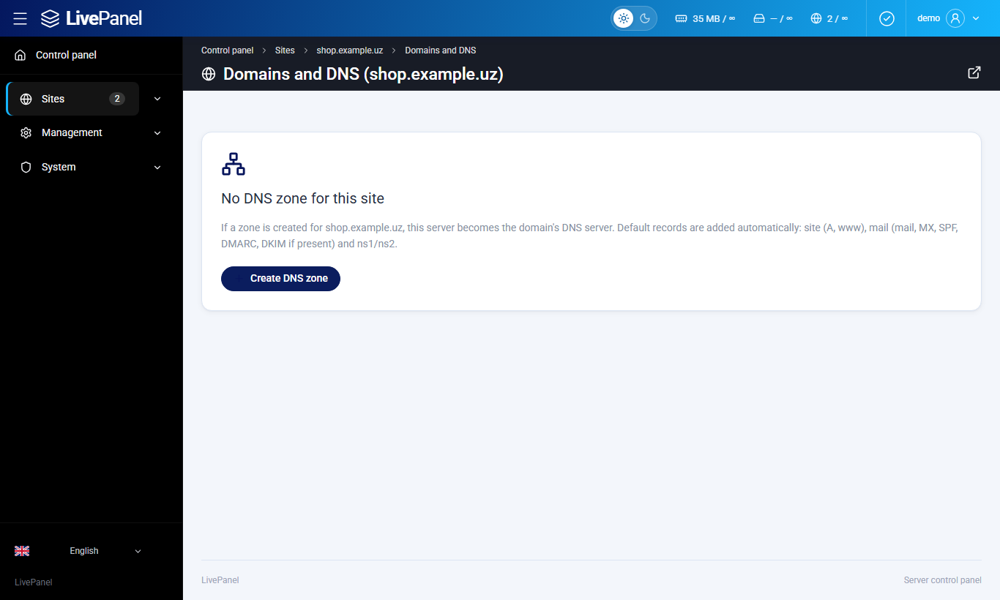

# Domenlar va DNS

Sayt ochilishi uchun domen server IP manziliga yo‘naltirilgan bo‘lishi kerak. Buni ikki usulda qilasiz:

1. **Domen registratori yoki tashqi DNS xizmatida** (masalan Cloudflare) A yozuvini qo‘shish — eng oddiy yo‘l.
2. **Shu serverni domenning DNS serveri qilish** — panelda DNS zonasi yaratiladi va barcha yozuvlarni paneldan boshqarasiz.

## 1-usul: A yozuvi

Domen registratorining DNS boshqaruvida quyidagi yozuvlarni qo‘shing:

| Nomi | Turi | Qiymati |
|---|---|---|
| `@` | A | server IP manzili |
| `www` | A | server IP manzili |

Pochta ishlatsangiz, MX, SPF, DKIM va DMARC yozuvlari ham kerak — ularni **Pochta** bo‘limi ko‘rsatadi: [Pochta](mail.md).

## 2-usul: panelda DNS zonasi

Serverda DNS serveri (BIND) o‘rnatilgan bo‘lishi kerak — **Tizim → Ilovalar** → `bind9`.

1. Sayt sahifasida **«Domenlar va DNS»** plitkasini oching.
2. **«DNS zonasini yaratish»** tugmasini bosing. Standart yozuvlar avtomatik qo‘shiladi:
   - sayt uchun `A` (`@` va `www`);
   - pochta uchun `mail`, `MX`, `SPF`, `DMARC` (va pochta yoqilgan bo‘lsa `DKIM`);
   - `ns1` va `ns2`.
3. Domen registratorida domenning **NS serverlarini** `ns1.<domen>` va `ns2.<domen>` qilib ko‘rsating va ularning IP manzilini (**glue yozuv**) server IP’si deb kiriting. Panel aniq qiymatlarni sahifada ko‘rsatadi.
4. NS o‘zgarishi internetga bir necha soatdan 48 soatgacha tarqaladi. Tekshirish: `dig NS example.uz`.

## Yozuvlarni boshqarish

**«Yozuv qo‘shish»** tugmasi va satr menyusidagi tahrirlash/o‘chirish. Har bir yozuvning **Nomi**, **Turi**, **Qiymati**, **TTL** va kerak bo‘lsa **Ustuvorlik** maydonlari bor.

| Turi | Vazifasi |
|---|---|
| A | Nom → IPv4 manzil. `@` — domenning o‘zi, `www` — www.domen |
| AAAA | Nom → IPv6 manzil |
| CNAME | Nom boshqa nomning taxallusi. Domenning o‘ziga (`@`) qo‘yib bo‘lmaydi; oxiridagi nuqta to‘liq nomni bildiradi |
| MX | Pochta serveri; kichik ustuvorlik raqami birinchi tanlanadi |
| TXT | SPF, DKIM, DMARC, domen tasdiqlash kodlari |
| NS | Domen yoki subdomenning DNS serverlari |
| SRV | Xizmat manzili: `og‘irlik port manzil` |
| CAA | Qaysi markaz SSL bera olishi, masalan `0 issue "letsencrypt.org"` |

Har saqlashda zona **seriya raqami** o‘zi oshadi. **«Zonani o‘chirish»** zonani butunlay olib tashlaydi — domen NS orqali shu serverga ulangan bo‘lsa, u ochilmay qoladi.
