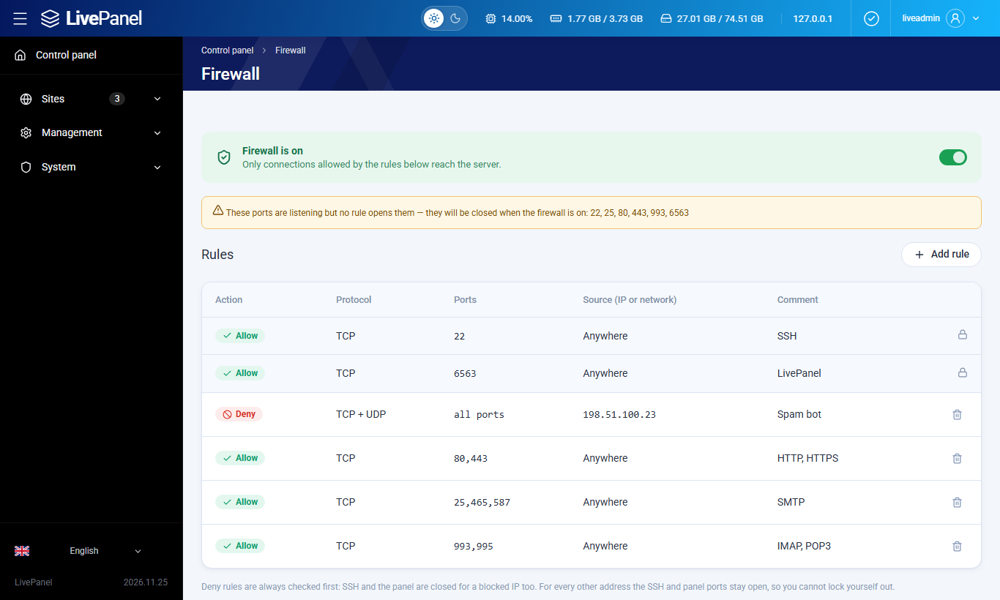

# Firewall

**Tizim → Firewall** (administrator uchun) serverga qaysi portlarga va qayerdan ulanish mumkinligini belgilaydi. Panel nftables qoidalarini boshqaradi.

## Yoqish

Firewall dastlab o‘chiq — server barcha portlarda ochiq. Yuqoridagi kalit bilan yoqilganda, faqat qoidalar ruxsat bergan ulanishlar serverga yetib keladi.

Panel ogohlantirishlari:
- **tinglanayotgan, lekin hech qaysi qoida ochmaydigan portlar** — firewall yoqilsa, ular yopiladi;
- serverda **ufw** ham yoqilgan bo‘lsa — ikkala firewall birga ishlaydi, ulanish o‘tishi uchun ikkalasi ham ruxsat berishi kerak.

## Qoidalar

Har bir qoidada:

| Maydon | Qiymat |
|---|---|
| **Amal** | **Ruxsat** yoki **Bloklash** |
| **Protokol** | TCP, UDP yoki ikkalasi |
| **Portlar** | bitta (`8080`), ro‘yxat (`80,443`) yoki oraliq (`3000-3010`); bo‘sh — barcha portlar |
| **Manba** | IP yoki tarmoq (`198.51.100.0/24`); bo‘sh — hamma joydan |
| **Izoh** | qoida nima uchun |

Standart qoidalar: HTTP/HTTPS (80, 443), va o‘rnatilgan bo‘lsa FTP, SMTP, IMAP/POP3.

- **Bloklash** qoidalari har doim birinchi tekshiriladi. Bloklash uchun manba majburiy; portsiz bo‘lsa, manba butunlay bloklanadi.
- **SSH va panel porti** uchun qoidalar tizim qoidasi — o‘chirib bo‘lmaydi, shuning uchun serverga kira olmay qolmaysiz.
- Bazaga tashqi ulanish yoqilgan bo‘lsa, 3306-port uchun ko‘rsatilgan manzillarga tizim qoidasi avtomatik qo‘shiladi — [Ma’lumotlar bazalari](databases.md).

## Saqlash va xavfsizlik

**«Saqlash va qo‘llash»** qoidalarni darhol qo‘llaydi. Agar qo‘llagandan keyin panel bir daqiqa ichida brauzeringiz bilan aloqani tasdiqlay olmasa (masalan, o‘zingizni bloklab qo‘ysangiz), **oldingi qoidalar avtomatik tiklanadi**.

Qoidalar server qayta yuklanganda ham saqlanib qoladi.

> Provayderingizning tashqi firewall’i (bulutli panelda) ham bo‘lishi mumkin — panel qoidalari undan keyin ishlaydi.
