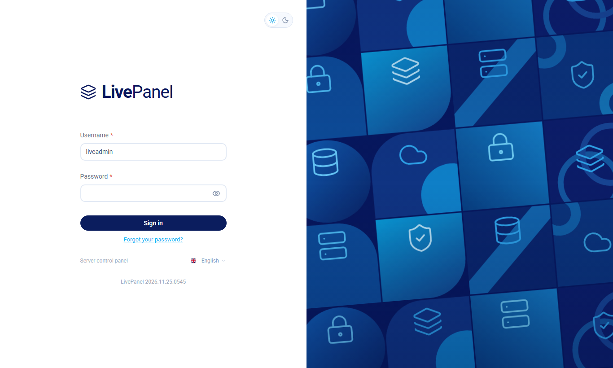
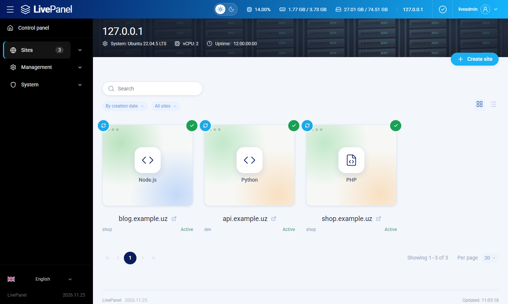
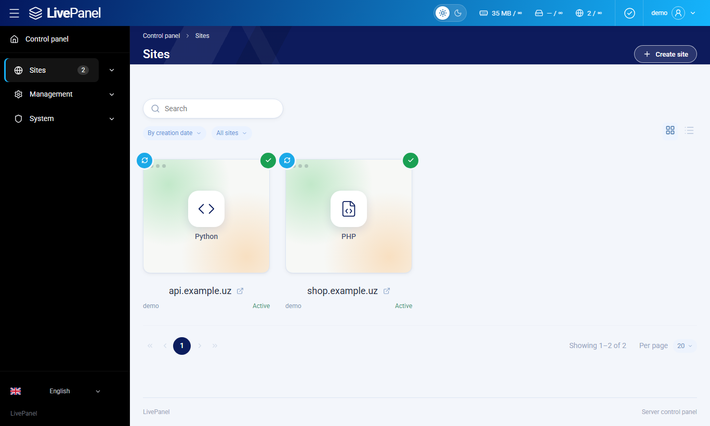

# Birinchi kirish va interfeys

## Kirish sahifasi

`https://SERVER_IP:6563` manzilida login va parolni kiriting. O‘ng pastdagi menyudan panel tilini tanlash, yuqoridagi tugmadan esa kunduzgi yoki tungi ko‘rinishni yoqish mumkin.

- **Parolni unutdingizmi?** — akkauntga tiklash emaili ulangan bo‘lsa, shu emailga yangi parol o‘rnatish havolasi yuboriladi (30 daqiqa amal qiladi).
- Bir necha marta noto‘g‘ri parol kiritilsa, IP manzil vaqtincha bloklanadi — [Panel sozlamalari va xavfsizlik](panel-settings.md).
- Ikki bosqichli kirish (2FA) yoqilgan bo‘lsa, paroldan keyin autentifikator ilovasidagi 6 xonali kod so‘raladi.

## Birinchi kirishdan keyin

1. **Litsenziyani faollashtiring** — panel litsenziyasiz ishlamaydi; Free tarif bepul. [Litsenziya va tariflar](license.md).
2. **Tiklash emailini kiriting** — panel uni birinchi kirishda so‘raydi. Parol esdan chiqsa, shu email orqali tiklaysiz.
3. **Parolni almashtiring** va **2FA’ni yoqing** — **Sozlamalar → Xavfsizlik** va **Ikki bosqichli kirish**.

## Panel tuzilishi

**Yuqori panel:**
- protsessor, tezkor xotira va disk band qilinishi, server IP manzili (administrator uchun);
- oddiy foydalanuvchida esa uning limitlari: ishlatilgan RAM, disk va saytlar soni;
- kunduzgi/tungi ko‘rinish tugmasi va akkaunt menyusi (sozlamalar, chiqish).

**Chap menyu:**

| Bo‘lim | Nima bor |
|---|---|
| **Boshqaruv paneli** | Server holati va saytlar kartalari |
| **Saytlar** | Saytlar ro‘yxati, yangi sayt, har bir saytning bo‘limlari |
| **Boshqaruv** | Fayllar, ma’lumotlar bazalari, SSL, DNS, pochta, FTP, cron, zaxira nusxalar |
| **Tizim** | Foydalanuvchilar, ilovalar, xizmatlar, firewall, statistika, terminal, amallar tarixi, litsenziya |

Bo‘limlar ro‘yxati akkaunt roliga qarab o‘zgaradi: oddiy foydalanuvchi server sozlamalarini ko‘rmaydi — [Foydalanuvchilar, rollar va limitlar](users.md).

## Saytlar sahifasi

Har bir sayt kartasida uning ko‘rinishi (skrinshoti), domeni, egasi va holati turadi. Kartani bossangiz, saytni boshqarish sahifasi ochiladi — [Saytni boshqarish](site-management.md). O‘ng yuqoridagi **«Sayt yaratish»** tugmasi sayt yaratish ustasini ochadi — [Sayt yaratish](create-site.md).

Ko‘rinishni kartalar yoki jadval qilib almashtirish, saytlarni qidirish va saralash mumkin.
