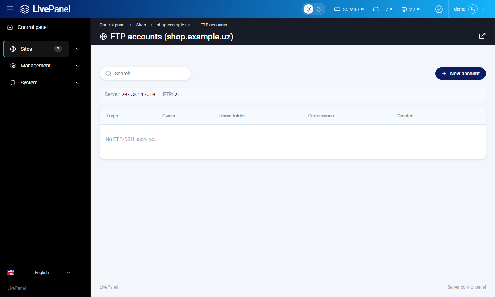

# FTP, SFTP va SSH

Fayllarni FileZilla, WinSCP kabi dasturlar orqali yuklash uchun FTP akkaunt yaratasiz. Buyruq satri kerak bo‘lsa, SSH ishlatasiz.

## FTP akkauntlar



Sayt sahifasidagi **«FTP akkauntlar»** plitkasini oching. Sahifa yuqorisida ulanish ma’lumotlari turadi: server manzili va FTP porti (21).

### Akkaunt yaratish

1. **«Yangi akkaunt»** tugmasini bosing.
2. **Login** — kichik lotin harflari, raqamlar, `_` va `-`; harf bilan boshlanadi (3–32 belgi).
3. **Sayt** — akkaunt shu sayt egasi nomidan ishlaydi.
4. **Uy papkasi** — akkaunt faqat shu papkani ko‘radi. Sayt papkasi yoki uning ichidagi papka bo‘lishi kerak.
5. **Ruxsatlar** — **Hammasiga ruxsat** yoki **Faqat o‘qish**.
6. Parolni kiriting yoki yarating va saqlang.

Akkauntni keyin tahrirlash, parolini almashtirish, vaqtincha o‘chirib qo‘yish yoki o‘chirish mumkin. Akkaunt o‘chirilsa, sayt fayllari o‘chmaydi.

### Ulanish

| | Qiymat |
|---|---|
| Xost | server IP manzili yoki domen |
| Protokol | FTP (21-port, passiv rejim) |
| Login / parol | yaratilgan akkaunt |

FTP akkaunt yaratilgan fayllar sayt egasiga tegishli bo‘ladi — sayt ularni muammosiz o‘qiydi.

## SFTP va SSH

SSH panel akkauntiga beriladi: administrator **Tizim → Foydalanuvchilar** bo‘limida akkaunt sozlamalaridagi **«SSH orqali kirishga ruxsat»** ni yoqadi. Shundan keyin:

- **Login** — akkaunt saytlarining Linux foydalanuvchisi (akkaunt ro‘yxatida «SSH login» ko‘rinadi);
- **Parol** — panel paroli bilan bir xil;
- **Port** — server SSH porti (odatda 22).

```bash
ssh shop@SERVER_IP
```

SFTP uchun FileZilla yoki WinSCP’da protokolni **SFTP** qilib tanlang, xuddi shu login va parol ishlaydi.

> SSH foydalanuvchisi himoyalangan muhitda ishlaydi: faqat o‘z uy papkasini ko‘radi va undan tashqariga chiqa olmaydi. Server bo‘ylab ishlash kerak bo‘lsa, administrator panel ichidagi [Terminal](terminal.md)dan root sifatida foydalanadi.

Noto‘g‘ri parol bilan ko‘p urinishlar fail2ban tomonidan bloklanadi — [Panel sozlamalari va xavfsizlik](panel-settings.md).
