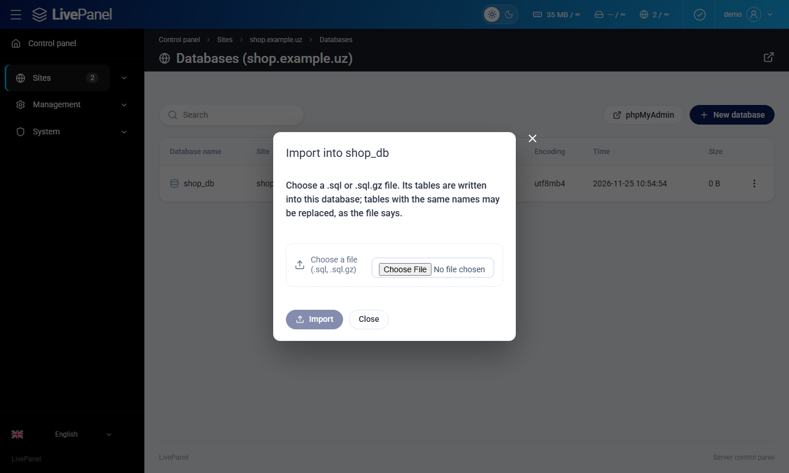

# Saytni boshqa hostingdan ko‘chirish

Bu qo‘llanmada boshqa hosting yoki paneldan (cPanel, ISPmanager, Plesk va boshqalar) PHP + MySQL saytni LivePanel’ga ko‘chiramiz — saytni to‘xtatmasdan.

## 1. Eski hostingdan nusxa oling

1. **Fayllar:** sayt papkasini (`public_html`, `httpdocs` yoki shunga o‘xshash) **ZIP yoki tar.gz** arxiv qilib yuklab oling.
2. **Baza:** phpMyAdmin’da **Export → SQL** (yoki `mysqldump`) — `.sql` yoki `.sql.gz` fayl.
3. Saytning sozlama faylidan baza nomi, foydalanuvchi va jadval prefiksini yozib oling (WordPress’da `wp-config.php`, Laravel’da `.env`).

## 2. LivePanel’da sayt yarating

1. **Saytlar → «Sayt yaratish» → PHP**.
2. Domen — xuddi eski saytdagi domen. **PHP versiyasini** eski hostingdagi bilan bir xil yoki yaqinini tanlang.
3. **Baza** kartasini yoqib, MySQL baza yarating yoki keyin **Ma’lumotlar bazalari** dan yarating. Parolni saqlab qo‘ying.

Domen hali eski serverga qaragan — bu normal: yangi sayt tayyor bo‘lguncha tashrifchilar eski saytni ko‘radi.

## 3. Fayllarni yuklang


1. **Fayllar** plitkasini oching va `www/<domen>` papkasiga kiring.
2. Panelning boshlang‘ich `index.php` / `index.html` faylini o‘chiring.
3. Arxivni yuklang (2 GB gacha) va **«Chiqarish»** bilan shu papkaga oching.
4. Fayllar arxiv ichidagi papkada qolgan bo‘lsa (masalan `public_html/`), ularni bir daraja yuqoriga ko‘chiring.

Katta saytlar uchun FTP/SFTP qulayroq — [FTP, SFTP va SSH](ftp-ssh.md).

## 4. Bazani import qiling



1. **Ma’lumotlar bazalari** → bazangiz menyusi → **«Import (.sql)»**.
2. `.sql` yoki `.sql.gz` faylni tanlang (2 GB gacha).

Boshqa serverdagi `DEFINER` lar avtomatik tozalanadi, view va triggerlar yangi baza foydalanuvchisiga o‘tadi. Batafsil — [Ma’lumotlar bazalari](databases.md).

## 5. Sozlamalarni yangilang

Sayt sozlama faylida yangi baza ma’lumotlarini yozing:

| | Qiymat |
|---|---|
| Xost | `localhost` |
| Baza nomi, foydalanuvchi, parol | 2-qadamda yaratilganlar |

- **WordPress:** `wp-config.php` → `DB_NAME`, `DB_USER`, `DB_PASSWORD`, `DB_HOST`.
- **Laravel:** `.env` → `DB_*`; so‘ng [Terminal](terminal.md)da `php artisan config:clear`.

> **Laravel va Symfony** loyihalarida tashrifchilarga faqat `public/` papkasi ochiq bo‘lishi kerak. Buning uchun 2-qadamda saytni **CMS / Framework → PHP → Framework → Laravel** (yoki Symfony) bilan yarating — panel web ildizni loyihaning `public/` papkasiga qo‘yadi. Keyin o‘rnatilgan namunaviy loyiha fayllarini o‘zingiznikiga almashtiring (`.env` va `storage/` ni ham).

## 6. DNS’ni almashtirishdan oldin tekshiring

Kompyuteringizning `hosts` fayliga vaqtincha yozing (Windows: `C:\Windows\System32\drivers\etc\hosts`, macOS/Linux: `/etc/hosts`):

```text
YANGI_SERVER_IP  example.uz www.example.uz
```

Brauzerda `http://example.uz` ni ochib, sayt yangi serverda to‘g‘ri ishlashini tekshiring. Xato bo‘lsa — **Loglar → Xatolar logi**. Tekshirgach, bu qatorni `hosts` dan o‘chiring.

## 7. DNS’ni yangi serverga o‘tkazing

1. Domen A yozuvlarini (`@` va `www`) yangi server IP’siga o‘zgartiring.
2. Tarqalishini kuting (bir necha soatgacha). Shu vaqt ichida eski saytga yangi buyurtma yoki izoh tushsa, bazani yana bir bor ko‘chirish kerak bo‘lishi mumkin — iloji bo‘lsa, ko‘chirish paytida eski saytni «texnik ishlar» rejimiga qo‘ying.
3. DNS yangi serverga qaragach — [SSL sertifikat](ssl.md) oling.
4. [Avtomatik zaxirani](backups.md) yoqing.

## 8. Pochta

Eski hostingdagi pochta qutilari avtomatik ko‘chmaydi. Yangi serverda qutilarni yarating ([Pochta](mail.md)), MX yozuvini o‘zgartiring, eski xatlarni esa pochta dasturida IMAP orqali bir qutidan ikkinchisiga sudrab ko‘chiring.

Eski hostingni bir-ikki hafta yopmay turing — hamma narsa ishlashiga ishonch hosil qilgach o‘chiring.
