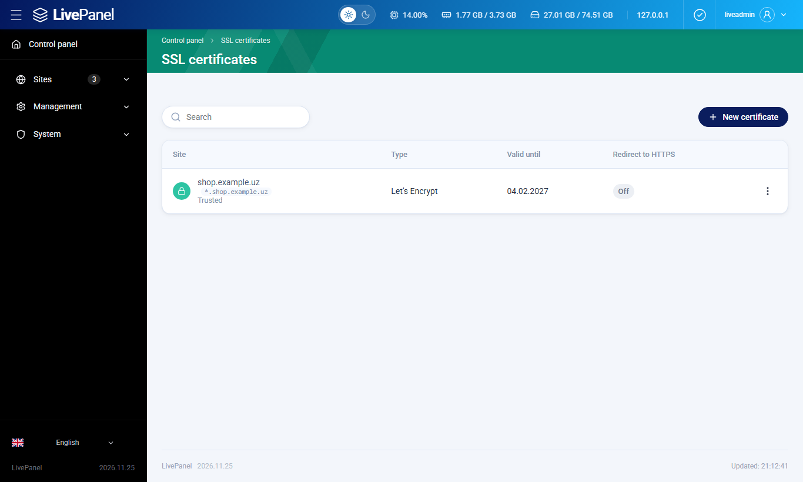

# WordPress sayt: noldan HTTPS’gacha

Bu qo‘llanmada domeningizda WordPress saytni ochamiz: sayt yaratish, WordPress o‘rnatish, SSL, pochta va avtomatik zaxira. Taxminan 10 daqiqa.

**Kerak bo‘ladi:** LivePanel o‘rnatilgan server, domen (masalan `example.uz`) va domen DNS’ini o‘zgartirish imkoni.

## 1. Domenni serverga yo‘naltiring

Domen registratoringiz panelida ikkita A yozuv qo‘shing:

| Nom | Turi | Qiymat |
|---|---|---|
| `@` | A | server IP manzili |
| `www` | A | server IP manzili |

DNS bir necha daqiqadan bir necha soatgacha tarqaladi. Tekshirish: `nslookup example.uz` server IP’sini ko‘rsatishi kerak. Batafsil — [Domenlar va DNS](dns.md).

## 2. Sayt va WordPress’ni yarating

1. **Saytlar → «Sayt yaratish»**.
2. Shablon: **CMS / Framework → PHP → CMS → WordPress**.
3. Domen: `example.uz`. Sayt foydalanuvchisi — **yangi foydalanuvchi**.
4. Sozlamalar qadamida WordPress uchun **sayt nomi**, **administrator logini**, **emaili** va **paroli**ni kiriting (parol kamida 12 belgi; panel tayyor parol taklif qiladi). PHP versiyasini qoldiring yoki eng yangisini tanlang.
5. **«Sayt yaratish»** ni bosing.

Panel WordPress’ni yuklaydi, MySQL baza yaratadi va `wp-config.php` ni sozlaydi. Oxirida admin panel havolasi (`https://example.uz/wp-admin/`) va baza ma’lumotlari chiqadi — saqlab qo‘ying. Batafsil — [CMS va frameworklarni o‘rnatish](app-installer.md).

## 3. SSL sertifikat oling

1. Sayt sahifasida **«SSL sertifikatlar» → «Yangi sertifikat»**.
2. **Let’s Encrypt** ni tanlang va **«Barcha HTTP so‘rovlarni HTTPS’ga yo‘naltirish»** ni yoqing.

Sayt endi `https://example.uz` da ochiladi. WordPress’da **Sozlamalar → Umumiy** bo‘limida ikkala manzil `https://` bilan boshlanganini tekshiring. Batafsil — [SSL sertifikatlar](ssl.md).

## 4. Pochta (ixtiyoriy)

`info@example.uz` kabi manzil kerak bo‘lsa — **Pochta → «Yangi domen»**, keyin quti yarating va DNS yozuvlarini (MX, SPF, DKIM, DMARC) qo‘shing. Batafsil — [Pochta](mail.md).

WordPress xatlari (parolni tiklash, buyurtmalar) yetib borishi uchun SMTP plaginida shu qutini ishlating: server — pochta serveri manzili, port 587, STARTTLS.

## 5. Avtomatik zaxira

1. Sayt sahifasida **«Zaxira nusxalar»**.
2. **Avtomatik zaxira → Har kuni**, saqlanadigan nusxalar — 7, **Fayllar** va **Ma’lumotlar bazalari** belgilangan.
3. Iloji bo‘lsa, **Sozlamalar → Zaxira serverlari** dan Google Drive yoki Dropbox’ni ulang va saytda yuborishni yoqing.

Batafsil — [Zaxira nusxalar](backups.md).

## 6. Tezlik va xavfsizlik

- **WP-Cron o‘rniga haqiqiy cron:** `wp-config.php` ga `define('DISABLE_WP_CRON', true);` qo‘shing va [Rejalashtiruvchi](cron.md)da har 5 daqiqaga `php /var/www/<foydalanuvchi>/data/www/example.uz/wp-cron.php` vazifasini qo‘shing.
- **Kesh:** **Tizim → Ilovalar** dan Redis o‘rnating va Redis Object Cache plaginidan foydalaning.
- **Katta rasm va plaginlar yuklash:** **Sozlamalar → Backend → PHP sozlamalari** da `upload_max_filesize` va `post_max_size` ni oshiring.
- **Admin panelni himoyalash:** `wp-admin` ga parol tanlash hujumlarini [Login himoyasi](panel-settings.md) va sayt sozlamalaridagi **so‘rovlar chegarasi** kamaytiradi; WordPress, plagin va mavzularni yangilab boring.
- **Virusga tekshirish:** vaqti-vaqti bilan **«Skanerlash»** plitkasidan foydalaning — [Sayt xavfsizligi va skanerlash](site-security.md).
