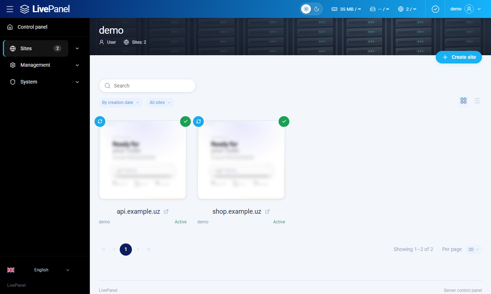

# LivePanel nima

**LivePanel** — Linux serverni va undagi saytlarni brauzer orqali boshqarish uchun hosting paneli. U serverga o‘rnatiladi va saytlar, ma’lumotlar bazalari, pochta, SSL sertifikatlar, zaxira nusxalar va serverning o‘zini bitta joydan boshqarish imkonini beradi. Buyruq satrini bilish shart emas.

> Rasmlarda panelning ingliz tilidagi ko‘rinishi berilgan. Panel tilini istalgan vaqtda chap pastdagi menyudan o‘zbek, rus yoki ingliz tiliga o‘zgartirasiz — tugma va bo‘lim nomlari matnda o‘zbekcha yozilgan.

## Panel nimalarni qila oladi

| Yo‘nalish | Imkoniyatlar |
|---|---|
| Saytlar | PHP (5.6–8.6), Node.js, Python, statik saytlar va reverse proxy; sayt yaratish ustasi; subdomenlar; backend turini keyin almashtirish |
| Ilovalar | WordPress, Joomla, Drupal, Laravel, Symfony, CodeIgniter, Strapi, Ghost, Express, Next.js, NestJS, Wagtail, Django, Flask, FastAPI — bir bosishda |
| Dasturlash | Git orqali deploy (webhook bilan avtomatik), muhit o‘zgaruvchilari, sayt xizmatlari va loglari, veb-terminal |
| Ma’lumotlar | MySQL 8 va PostgreSQL, phpMyAdmin va Adminer’ga parolsiz kirish, import/eksport, qo‘shimcha foydalanuvchilar va tashqi ulanish |
| Xavfsizlik | Bepul Let’s Encrypt SSL, firewall, login himoyasi va fail2ban, ikki bosqichli kirish (2FA), saytni IP bo‘yicha yopish, ClamAV antivirus |
| Pochta | Pochta domenlari, qutilar, yo‘naltirishlar, DKIM, Roundcube webmail |
| Zaxira | Jadval bo‘yicha zaxira, bir bosishda tiklash, Google Drive va Dropbox’ga nusxa yuborish |
| Boshqaruv | Foydalanuvchilar va resellerlar, disk/RAM/domen limitlari, statistika va trafik, brending, API, avtomatik yangilanish |

## Kimlar uchun

- **O‘z serveri bor dasturchi va kompaniyalar** — VPS’ga panel o‘rnatib, saytlarini o‘zlari boshqaradi.
- **Hosting xizmati ko‘rsatuvchilar** — mijozlarga alohida akkaunt, limit va o‘z brendi bilan panel beradi (reseller).
- **Agentliklar** — har bir mijoz sayti alohida Linux foydalanuvchisida, bir-biridan ajratilgan holda ishlaydi.

## Qanday ishlaydi

- Panel serverda ikki qismdan iborat: veb-interfeys (6563-port) va root huquqli agent. Agent faqat server ichidagi soket orqali ishlaydi va tashqaridan ochiq emas.
- Har bir sayt **o‘z Linux foydalanuvchisi** nomidan ishlaydi: PHP-FPM pool, Node.js/Python xizmati, cron vazifalari va fayllar shu foydalanuvchiga tegishli. Bitta sayt buzilsa, boshqalariga ta’sir qilmaydi.
- Web server — **Nginx**. PHP uchun PHP-FPM (yoki FastCGI, Apache, CGI), Node.js va Python ilovalar systemd xizmati sifatida ishlaydi.
- Panel litsenziyasi livepanel.uz’da beriladi. **Free** tarif bepul va muddatsiz.

## Keyingi qadam

1. [O‘rnatish](installation.md) — serverga bitta buyruq bilan o‘rnatish.
2. [Birinchi kirish va interfeys](first-login.md) — panel tuzilishi bilan tanishish.
3. [Sayt yaratish](create-site.md) — birinchi saytni ishga tushirish.
