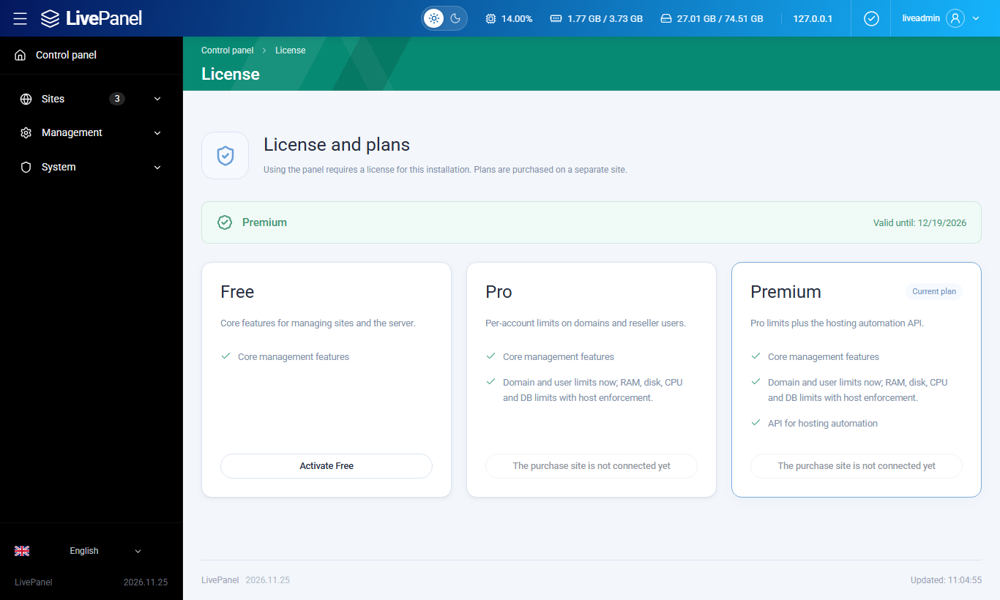

# Litsenziya va tariflar

Panel ishlashi uchun shu o‘rnatishga tegishli litsenziya kerak. Litsenziya livepanel.uz’da beriladi va **server IP manziliga bog‘lanadi**.

## Tariflar

| | Free | Pro | Premium |
|---|---|---|---|
| Narxi | Bepul, muddatsiz | Oylik to‘lov | Oylik to‘lov |
| Saytlar, bazalar, pochta, SSL, zaxira, Git va boshqa barcha asosiy funksiyalar | ✅ | ✅ | ✅ |
| Akkauntlar bo‘yicha domen, disk, RAM, baza va reseller limitlari | — | ✅ | ✅ |
| Hosting avtomatizatsiyasi API (tokenlar) | — | — | ✅ |
| Wildcard SSL sertifikat (`*.domen`) | — | — | ✅ |
| Sahifa keshi, WebP/AVIF rasmlar, saytga alohida Redis, davlat bo‘yicha bloklash | — | ✅ | ✅ |
| Hujum rejimi (L7 hujumdan himoya) | — | — | ✅ |

Joriy narxlar: [livepanel.uz](https://livepanel.uz) → **Narxlar**.

## Free litsenziyani faollashtirish

1. Panelda **Tizim → Litsenziya** sahifasini oching.
2. **Free** kartasida **«Free’ni aktivlashtirish»** tugmasini bosing.
3. livepanel.uz sahifasi ochiladi: hisobingizga kiring (yoki ro‘yxatdan o‘ting) va tasdiqlang.
4. Litsenziya panelga avtomatik yuboriladi — panel sahifasini yangilang.

## Pro yoki Premium sotib olish

1. **Tizim → Litsenziya** sahifasida kerakli tarif kartasini bosing.
2. livepanel.uz’da to‘lov sahifasi ochiladi — server manzili avtomatik to‘ldirilgan bo‘ladi.
3. To‘lovdan so‘ng litsenziya panelga **avtomatik o‘rnatiladi**, kalit kiritish shart emas. Panel uni bir necha daqiqada o‘zi ham tekshirib oladi.

Litsenziyani livepanel.uz kabinetidagi **Kalitlar** bo‘limidan ham ko‘rasiz, uzaytirasiz va boshqarasiz.

## Litsenziya kalitlari qanday himoyalangan

- **Kalit kiritish yoki kod bilan faollashtirish yo‘q.** Pullik litsenziya to‘lovdan keyin livepanel.uz’dan panelga o‘zi keladi; panel ham uni bir necha daqiqada o‘zi so‘rab oladi. Paneldagi tugma faqat **Free** tarifini faollashtiradi.
- **Past tarif yuqorisini almashtirmaydi.** Panelda faol Premium bo‘lsa, Free yoki Pro kaliti uni almashtira olmaydi (panel «Panelda allaqachon yaxshiroq litsenziya bor» deydi). Bir xil tarifda esa muddati uzunroq kalit qoladi.
- **Kalit faqat o‘z serveriga beriladi.** livepanel.uz kalitni faqat litsenziya bog‘langan server IP manziliga, yoki sotib olishda ko‘rsatilgan server manziliga beradi. O‘rnatish ID’sini bilish kalitni olish uchun yetmaydi.

## Muddat tugasa

- Muddat tugashiga 5 kun qolganda kabinetda ogohlantirish chiqadi.
- Muddat tugasa, panel funksiyalari vaqtincha to‘xtaydi, **saytlar esa ishlashda davom etadi**.
- Uzaytirish uchun **Litsenziya** sahifasidagi **«Uzaytirish»** ni bosing. To‘lovdan keyin **«Qayta tekshirish»** tugmasi yangi kalitni darhol oladi.

## Serverni ko‘chirish

Litsenziya bitta IP manzilga bog‘langan. Panelni boshqa serverga o‘tkazsangiz, livepanel.uz kabinetidagi **Kalitlar** bo‘limida litsenziyani yangi serverga **ko‘chiring**. Eski server 24 soatdan ortiq ishlamasa, litsenziya yangi serverga o‘zi o‘tadi.

> Panel «Litsenziya boshqa serverga bog‘langan» desa — xuddi shu holat: kabinetda ko‘chirish tugmasini bosing.
