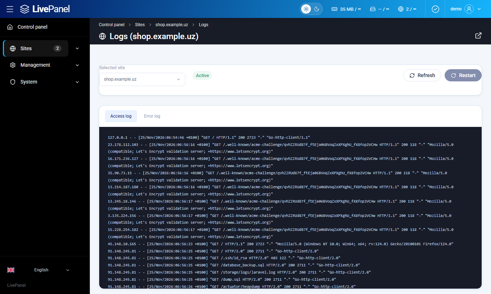

# Loglar

Loglar saytga kelgan so‘rovlar va xatolarni ko‘rsatadi — sayt ishlamay qolganda birinchi qaraladigan joy. Sayt sahifasidagi **«Loglar»** plitkasidan ochiladi (akkauntda **«Sayt xizmatlari va loglari»** ruxsati bo‘lishi kerak).

## Log turlari

| Yorliq | Nimani ko‘rsatadi |
|---|---|
| **So‘rovlar logi** | Saytga kelgan har bir so‘rov: IP manzil, vaqt, sahifa, javob kodi, hajm, brauzer |
| **Xatolar logi** | Nginx va PHP xatolari: topilmagan fayllar, ruxsat xatolari, PHP fatal error’lar |
| **Ilova logi** | Node.js va Python saytlarda ilovaning o‘zi chiqargan matn (systemd journal) — ishga tushishdagi xatolar shu yerda |

Oxirgi yozuvlar ko‘rsatiladi. **«Yangilash»** tugmasi logni qayta yuklaydi.

## Xizmatni qayta ishga tushirish

Yuqorida saytning xizmati va holati ko‘rinadi (masalan, **Faol**). **«Qayta ishga tushirish»** tugmasi:

- PHP saytda saytning PHP-FPM poolini qayta yuklaydi;
- Node.js va Python saytda ilova xizmatini qayta ishga tushiradi — kod o‘zgargandan keyin shu tugmani bosasiz.

## Javob kodlari

| Kod | Ma’nosi |
|---|---|
| 200 | So‘rov muvaffaqiyatli |
| 301 / 302 | Yo‘naltirish |
| 403 | Ruxsat yo‘q — sayt o‘chirib qo‘yilgan, IP bloklangan yoki papkada bosh sahifa yo‘q |
| 404 | Fayl topilmadi |
| 500 | Ilova xatosi — **Xatolar logi** yoki **Ilova logi**ni ko‘ring |
| 502 | Ilova ishlamayapti yoki javob bermayapti — **Ilova logi**ni ko‘ring |
| 504 | Ilova juda uzoq javob berdi |

Loglarni yozishni sayt sozlamalarida o‘chirish mumkin — [Sayt sozlamalari](site-settings.md). Kirishlar logi o‘chirilsa, trafik statistikasi hisoblanmaydi.
