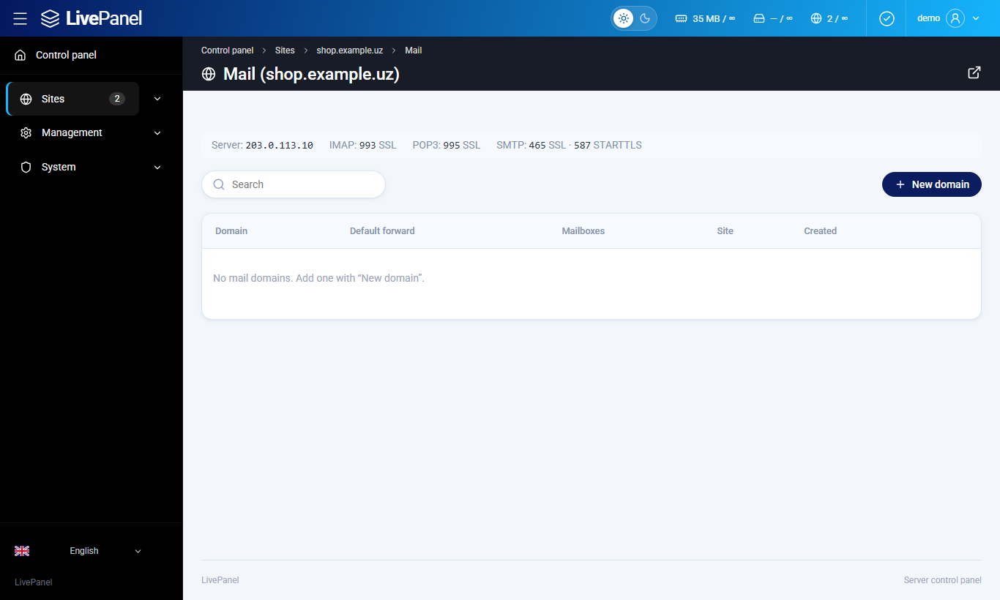

# Pochta

Panel domeningiz uchun pochta serverini sozlaydi: `info@example.uz` kabi qutilar, yo‘naltirishlar, spamga tushmaslik uchun DKIM imzosi va brauzerdan kirish uchun **Roundcube** webmail. Pochta serveri (Exim va Dovecot) birinchi domen qo‘shilganda avtomatik o‘rnatiladi — bu 2–5 daqiqa olishi mumkin.

Sahifa yuqorisida ulanish ma’lumotlari turadi: server manzili, IMAP (993, SSL), POP3 (995, SSL), SMTP (465 SSL va 587 STARTTLS).

## 1. Pochta domenini qo‘shish

1. **«Yangi domen»** tugmasini bosing.
2. **Domen** — pochta manzillari shu domenda bo‘ladi (`info@domen`). Sayt nomidan farq qilishi mumkin.
3. **Sayt** — domen qaysi saytga tegishli.
4. Saqlang. Domen uchun DKIM kaliti yaratiladi.

Domen sozlamalarida:
- **Standart yo‘naltirish** (catch-all) — mavjud bo‘lmagan manzillarga kelgan xatlar shu manzilga yuboriladi; bo‘sh qolsa, rad etiladi;
- **Pochta yoqilgan** kaliti — o‘chirilsa, domen xat qabul qilmaydi.

## 2. DNS yozuvlarini qo‘shish

Xatlar yetib kelishi va spamga tushmasligi uchun domen DNS’ida quyidagi yozuvlar bo‘lishi shart. Panel aniq qiymatlarni **«DNS yozuvlari»** oynasida ko‘rsatadi:

| Yozuv | Vazifasi |
|---|---|
| `MX` | Domen pochtasi shu serverga kelishi |
| `A` (`mail`) | Pochta serveri manzili |
| `TXT` SPF | Shu server domen nomidan xat yuborishga ruxsatli ekani |
| `TXT` DKIM | Xatlar imzosi |
| `TXT` DMARC | SPF/DKIM tekshiruvi o‘tmagan xatlar bilan nima qilish |

DNS zonasi shu serverda bo‘lsa, yozuvlar avtomatik qo‘shiladi — [Domenlar va DNS](dns.md).

## 3. Pochta qutisi yaratish

1. Domenni tanlab, **«Yangi quti»** ni bosing.
2. **Login** — manzilning `@` gacha qismi (`info`).
3. **Parol** — kuchli parol; panel uning kuchini ko‘rsatadi va tayyor parol yaratadi.
4. **Aliaslar** — shu qutiga keladigan qo‘shimcha nomlar, har biri yangi qatorda (`sales` → `sales@domen`).
5. **Yo‘naltirishlar** — har bir xatning nusxasi shu manzillarga ham yuboriladi (qutida ham qoladi).
6. **Kvota (MB)** — qutining hajmi; 0 — cheklanmagan.

Qutini vaqtincha o‘chirib qo‘yish mumkin — kirish va xat qabul qilish to‘xtaydi.

## Pochta dasturlarini sozlash

Outlook, Thunderbird, telefon pochta ilovalarida:

| | Server | Port | Shifrlash |
|---|---|---|---|
| Kiruvchi (IMAP) | server manzili | 993 | SSL/TLS |
| Kiruvchi (POP3) | server manzili | 995 | SSL/TLS |
| Chiquvchi (SMTP) | server manzili | 465 yoki 587 | SSL/TLS yoki STARTTLS |

Login — to‘liq manzil (`info@example.uz`), parol — qutining paroli.

## Webmail

**Roundcube** o‘rnatilgan bo‘lsa (**Tizim → Ilovalar** → `roundcube`), pochtaga brauzerdan `https://SERVER:6563/webmail/` manzilida kirasiz. Sahifadagi **«Webmail (Roundcube)»** havolasi ham shu yerga olib boradi.

## Xat yuborilmasa

- Ko‘p VPS provayderlari spamga qarshi **chiquvchi 25-portni yopadi**. Panel buni aniqlasa ogohlantiradi: xat qabul qilish ishlaydi, lekin tashqi pochtalarga (Gmail va boshqalar) xat ketmaydi. Portni ochish uchun provayderingizga murojaat qiling.
- Xatlar spamga tushsa — SPF, DKIM va DMARC yozuvlarini hamda serverning **PTR (reverse DNS)** yozuvi `mail.domen` ga qaratilganini tekshiring (PTR provayderda sozlanadi).
