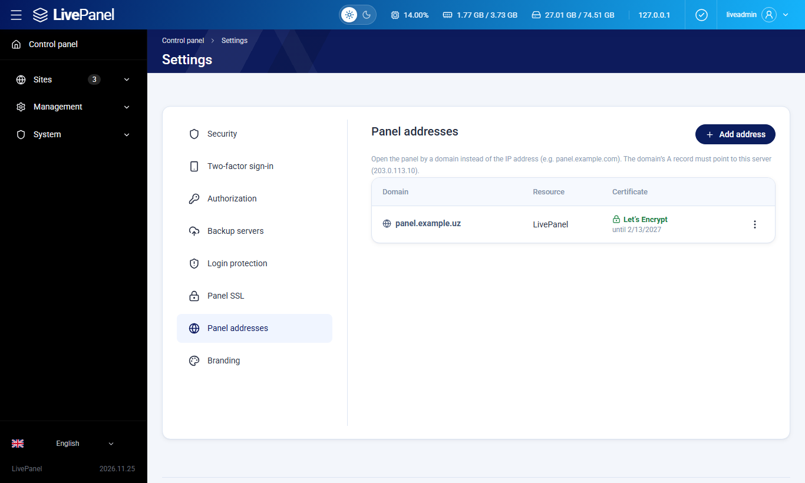
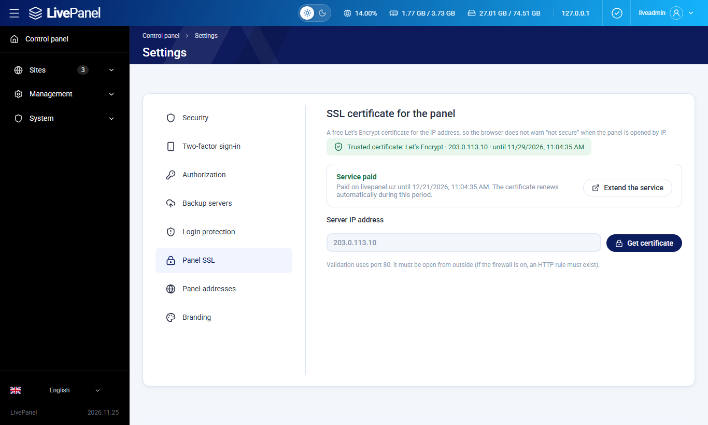

# Panel manzili va SSL

Panel dastlab `https://SERVER_IP:6563` manzilida o‘zi yaratgan (self-signed) sertifikat bilan ochiladi va brauzer «xavfsiz emas» deb ogohlantiradi. Buni ikki usulda tuzatasiz.

## 1. Panel manzillari: domen orqali kirish

**Sozlamalar → Panel manzillari** (administrator uchun) — panelga IP o‘rniga domen orqali kirish, masalan `https://panel.example.uz`.

1. Domenning **A yozuvini** server IP manziliga yo‘naltiring.
2. **«Manzil qo‘shish»** ni bosing va domenni kiriting.
3. **Sertifikat turi**:
   - **Let’s Encrypt** — bepul ishonchli sertifikat, avtomatik yangilanadi;
   - **O‘z-o‘zidan imzolangan**;
   - **Mavjud sertifikat** — o‘z sertifikatingiz va yopiq kalitingizni (PEM) joylaysiz.
4. Saqlang. Panel endi `https://panel.example.uz` da ochiladi (port ko‘rsatish shart emas).

Let’s Encrypt sertifikat bera olmasa, vaqtincha o‘z-o‘zidan imzolangan sertifikat qo‘yiladi va sababi ko‘rsatiladi.

## 2. Panel SSL: IP manzil uchun sertifikat

**Sozlamalar → Panel SSL** — domen bo‘lmasa ham panel IP manzil orqali ishonchli sertifikat bilan ochiladi. Sertifikat Let’s Encrypt’dan IP manzilga olinadi.

- Bu livepanel.uz’ning pullik xizmati (oylik). Sahifadagi **«livepanel.uz da sotib olish»** tugmasi to‘lov sahifasini ochadi.
- To‘lovdan keyin **«Sertifikat olish»** ni bosing — panel 30 soniya ichida yangi sertifikatga o‘tadi.
- IP sertifikatlari qisqa muddatli (~6 kun): xizmat to‘langan davrda panel ularni o‘zi yangilaydi. Xizmat tugasa, panel o‘z sertifikatiga qaytadi va ochilaveradi.
- Tekshiruv 80-port orqali o‘tadi — u tashqaridan ochiq bo‘lishi kerak.

## Panel porti

Panel 6563-portda ishlaydi. Provayderning tashqi firewall’ida bu port ochiq bo‘lishi kerak. Panel manzillari ishlatilsa, panel 443-port orqali ham ochiladi.
