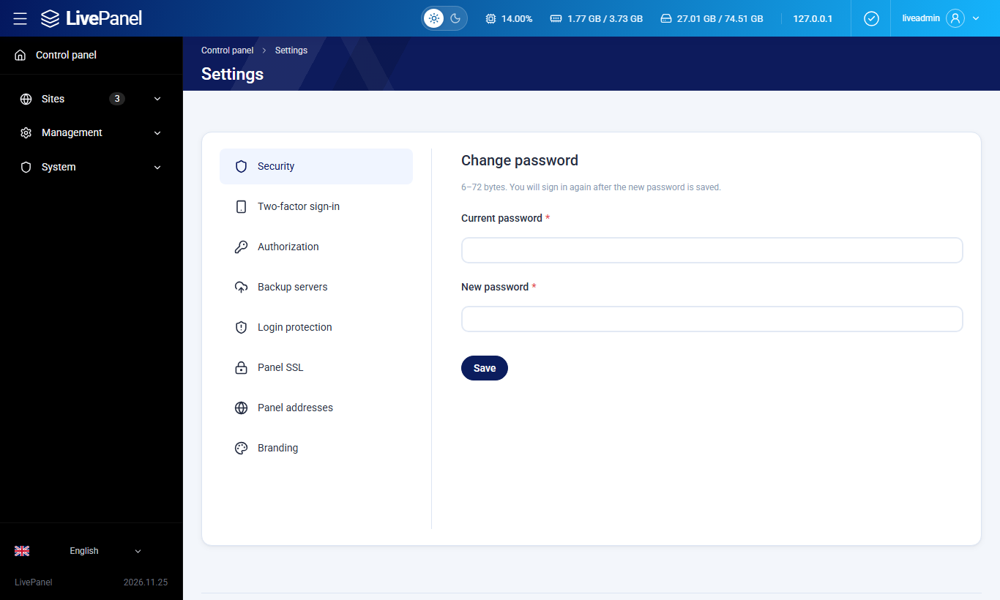
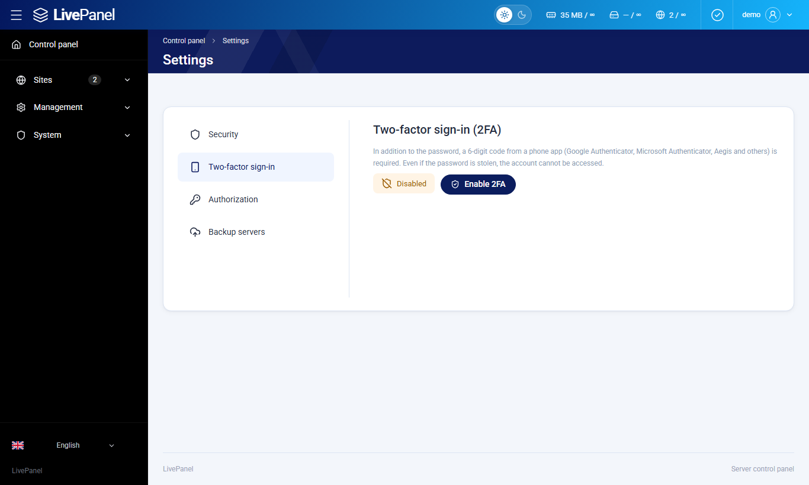
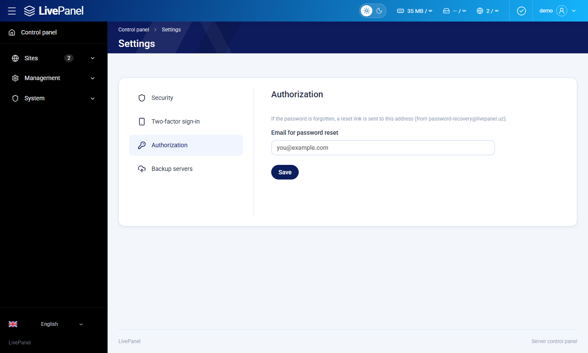
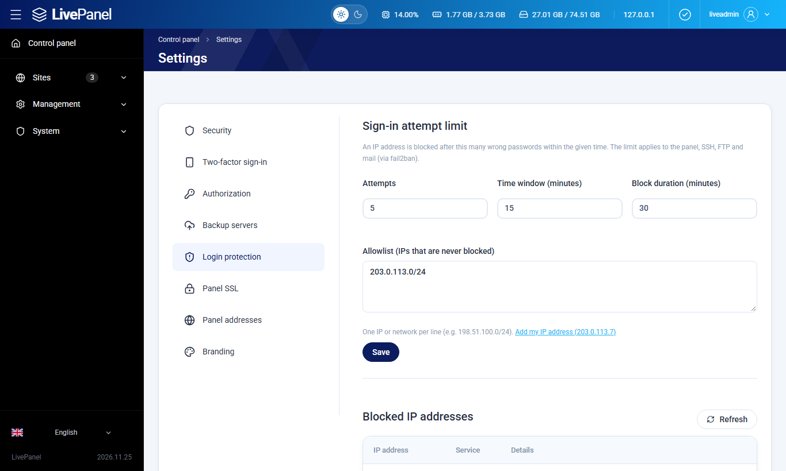
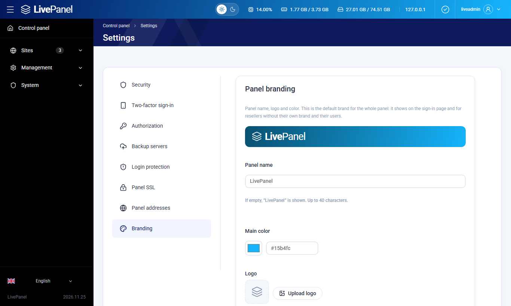

# Panel sozlamalari va xavfsizlik

Akkaunt menyusidagi **Sozlamalar** sahifasida panel va akkaunt xavfsizligi sozlanadi. Bo‘limlar ro‘yxati rolga qarab o‘zgaradi.

## Xavfsizlik: parolni o‘zgartirish

**Amaldagi parol** va **yangi parol**ni (6–72 belgi) kiriting. Saqlangach panelga yangi parol bilan qaytadan kirasiz.

## Ikki bosqichli kirish (2FA)

Parolga qo‘shimcha ravishda telefondagi ilova (Google Authenticator, Microsoft Authenticator, Aegis va boshqalar) beradigan 6 xonali kod so‘raladi. Parol o‘g‘irlansa ham akkauntga kirib bo‘lmaydi.

1. **«2FA ni yoqish»** ni bosing.
2. Ilovada QR kodni skanerlang (yoki maxfiy kalitni qo‘lda kiriting).
3. Ilova ko‘rsatgan kodni kiriting va **«Tasdiqlash va yoqish»** ni bosing.
4. **Zaxira kodlarni saqlab oling** — telefon yo‘qolsa, shulardan biri bilan kirasiz (har biri bir marta ishlaydi, boshqa ko‘rsatilmaydi).

Telefonni ham, kodlarni ham yo‘qotgan foydalanuvchi uchun administrator **Foydalanuvchilar** bo‘limida 2FA’ni o‘chiradi.

## Avtorizatsiya: tiklash emaili

**Parolni tiklash uchun email** — parol esdan chiqsa, kirish sahifasidagi «Parolni unutdingizmi?» shu manzilga tiklash havolasini yuboradi (password-recovery@livepanel.uz dan, 30 daqiqa amal qiladi). Panel xabarnomalari ham shu manzilga keladi.

## Login himoyasi (administrator)

Bitta IP manzildan belgilangan vaqt ichida shuncha marta noto‘g‘ri parol kiritilsa, u bloklanadi. Chegara panelga, SSH, FTP va pochtaga (fail2ban orqali) qo‘llanadi.

- **Urinishlar soni**, **Vaqt oralig‘i (daqiqa)**, **Blok muddati (daqiqa)**.
- **Oq ro‘yxat** — hech qachon bloklanmaydigan IP lar; **«Mening IP manzilimni qo‘shish»** tugmasi bilan o‘zingizni qo‘shing.
- **Bloklangan IP manzillar** — qaysi xizmatda bloklangani; **«Blokdan chiqarish»**.
- **Himoyalangan xizmatlar (fail2ban)** — har bir xizmat bo‘yicha xatolar va bloklar soni. fail2ban o‘rnatilmagan bo‘lsa, uni **Ilovalar** bo‘limidan o‘rnating.

## Brending (administrator va reseller)

- **Panel nomi** (40 belgigacha), **Asosiy rang** va **Logotip** (PNG, JPEG, WebP yoki GIF, 1 MB gacha).
- Administrator brendi butun panel uchun standart: kirish sahifasida va o‘z brendini sozlamagan resellerlarda ko‘rinadi.
- Reseller brendini u yaratgan foydalanuvchilar ko‘radi.
- **«Standartga qaytarish»** LivePanel ko‘rinishini tiklaydi.

## Boshqa bo‘limlar

- **Zaxira serverlari** — Google Drive va Dropbox: [Zaxira nusxalar](backups.md).
- **Panel SSL** va **Panel manzillari** — [Panel manzili va SSL](panel-access.md).
- **Avtomatik yangilash** — yangilanishlarni avtomatik qabul qilish (standart holatda o‘chirilgan) va **Yangilash** tugmasi: [Yangilanishlar va xabarnomalar](updates-notifications.md).
