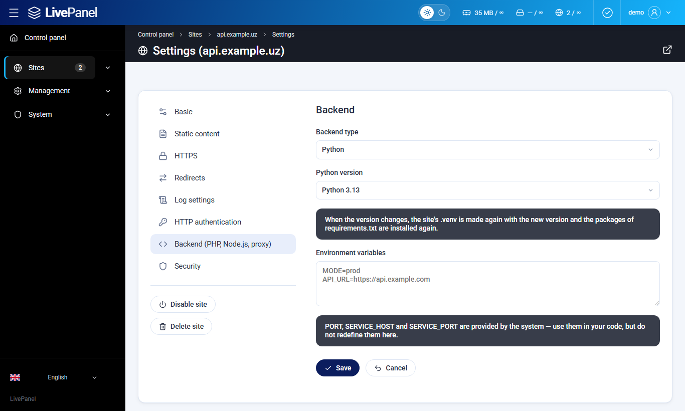

# Python va Node.js saytlar

Node.js va Python saytlar PHP’dan farqli ishlaydi: ilova doimiy ishlaydigan **systemd xizmati** sifatida sayt foydalanuvchisi nomidan ishga tushadi va serverning ichki portida tinglaydi, Nginx esa domenga kelgan so‘rovlarni unga uzatadi. Xizmat server qayta yuklanganda o‘zi ishga tushadi va to‘xtab qolsa qayta yoqiladi.

## Versiyalar

- **Node.js** — panel bilan birga Node.js LTS o‘rnatiladi. Boshqa versiyalar (16–26) **Tizim → Ilovalar** bo‘limidan o‘rnatiladi.
- **Python** — panel bilan birga kelmaydi: kerakli versiyani (3.11, 3.12, 3.13, 3.14, 3.15) **Tizim → Ilovalar** bo‘limidan o‘rnating. Versiyalar rasmiy python-build-standalone yig‘malaridan olinadi va tizimdagi Python’ga tegmaydi.

Saytning versiyasini keyin **Sozlamalar → Backend** bo‘limida o‘zgartirasiz.

## Node.js sayt

Sayt papkasida **`app.js`** turadi — xizmat aynan shu faylni `node app.js` bilan ishga tushiradi. Ilovangiz:

- portni `process.env.PORT` dan olishi va `127.0.0.1` da tinglashi kerak:

  ```js
  const express = require("express");
  const app = express();
  app.get("/", (req, res) => res.send("Salom!"));
  app.listen(Number(process.env.PORT), "127.0.0.1");
  ```

- loyiha boshqa faylda bo‘lsa, `app.js` ichida uni ulang: `require("./server.js")` yoki `import("./dist/main.js")`.

Paketlar: `npm install` ni SSH yoki [Terminal](terminal.md)da sayt papkasida bajaring, yoki [Git deploy](git-deploy.md) buyrug‘iga qo‘shing.

## Python sayt



Sayt papkasida:

| Fayl | Vazifasi |
|---|---|
| `app.py` | Boshlang‘ich WSGI ilova (`application` obyekti) |
| `gunicorn.conf.py` | Gunicorn sozlamalari: qaysi ilova ishga tushadi (`wsgi_app`), workerlar soni, worker turi |
| `.venv/` | Saytning o‘z Python virtual muhiti, Gunicorn shu yerda |
| `requirements.txt` | Loyiha paketlari (ixtiyoriy) |

Xizmat `.venv/bin/gunicorn --config gunicorn.conf.py` bilan ishga tushadi. O‘z loyihangizni ulash uchun `gunicorn.conf.py` dagi `wsgi_app` ni o‘zgartiring:

```python
wsgi_app = "myproject.wsgi:application"   # Django
wsgi_app = "app:app"                        # Flask
```

FastAPI kabi ASGI ilovalar uchun `uvicorn-worker` paketini o‘rnating va qo‘shing:

```python
worker_class = "uvicorn_worker.UvicornWorker"
```

Paketlar saytning muhitiga o‘rnatiladi:

```bash
cd /var/www/<foydalanuvchi>/data/www/<domen>
.venv/bin/pip install -r requirements.txt
```

Python versiyasi o‘zgartirilsa, `.venv` yangi versiya bilan qayta yaratiladi va `requirements.txt` dagi paketlar qayta o‘rnatiladi.

## Muhit o‘zgaruvchilari

**Sozlamalar → Backend → Muhit o‘zgaruvchilari** — har qatorga `KALIT=qiymat` (masalan `DATABASE_URL=...`). Saqlanganda xizmat qayta ishga tushadi. `PORT` tizim tomonidan beriladi — uni qayta belgilamang.

## Kod o‘zgargandan keyin

Ilova xotirada ishlaydi, shuning uchun faylni o‘zgartirgandan keyin xizmatni qayta ishga tushiring: **Loglar → «Qayta ishga tushirish»**. Git deploy buni o‘zi qiladi.

## Ilova ishlamasa

1. **Loglar → Ilova logi** — ishga tushishdagi xato (masalan, paket topilmadi) shu yerda.
2. Ilova `PORT` muhit o‘zgaruvchisidagi portda va `127.0.0.1` da tinglayotganini tekshiring.
3. Sayt **502** qaytarsa, ilova ishlamayapti yoki boshqa portda tinglamoqda.
