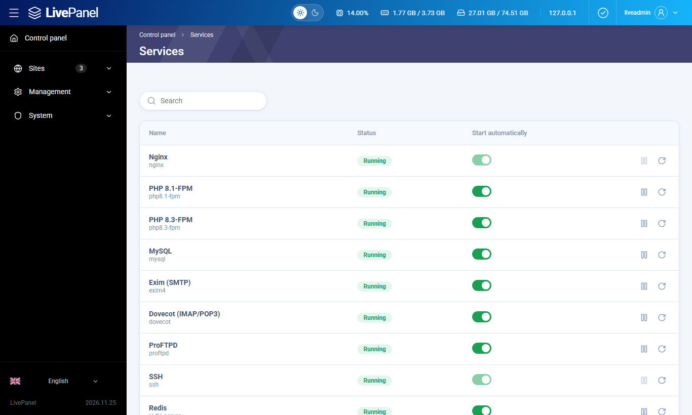

# Tizim xizmatlari

**Tizim → Xizmatlar** (administrator uchun) serverdagi asosiy xizmatlarning holatini ko‘rsatadi va ularni boshqarish imkonini beradi.

Ro‘yxatda Nginx, PHP-FPM (har bir o‘rnatilgan versiya), MySQL, PostgreSQL, Exim (SMTP), Dovecot (IMAP/POP3), ProFTPD, SSH, Redis, fail2ban va boshqa o‘rnatilgan xizmatlar turadi. Har birida:

- **Holat** — ishlayapti yoki to‘xtagan;
- **Avtomatik ishga tushish** kaliti — server qayta yuklanganda xizmat o‘zi yoqiladimi;
- amallar: **Ishga tushirish**, **To‘xtatish**, **Qayta ishga tushirish**.

Ba’zi xizmatlar server bilan aloqani saqlaydi va to‘xtatib bo‘lmaydi: masalan SSH faqat qayta ishga tushiriladi, Nginx esa panel ishlashi uchun kerak.

## Qachon kerak

- Sozlama o‘zgargandan keyin xizmat yangi sozlamani olmasa — **Qayta ishga tushirish**.
- Xizmat ishlatilmasa (masalan pochta kerak emas) — uni to‘xtatib, avtomatik ishga tushishni o‘chirib, xotirani bo‘shatish.
- Muhim xizmat to‘xtab qolsa, panel administratorga email yuboradi — [Yangilanishlar va xabarnomalar](updates-notifications.md).

Saytning o‘z xizmati (PHP pool, Node.js/Python ilova) sayt sahifasidagi **Loglar** bo‘limidan qayta ishga tushiriladi — [Loglar](logs.md).
