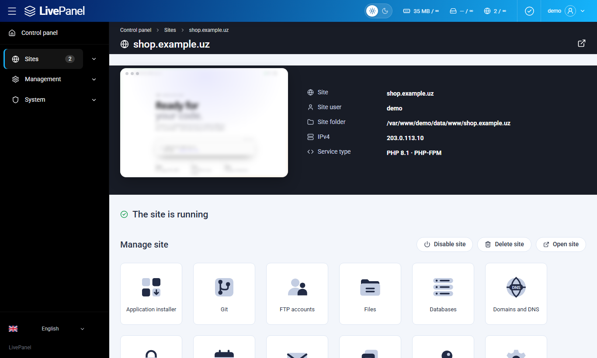

# Saytni boshqarish

Saytlar ro‘yxatida kartani bossangiz, **sayt sahifasi** ochiladi. U yerda sayt haqidagi asosiy ma’lumotlar va uning barcha bo‘limlari plitka ko‘rinishida turadi.

## Sayt haqidagi ma’lumot

- **Sayt** — domen; yonidagi belgi saytni yangi oynada ochadi.
- **Sayt foydalanuvchisi** — sayt qaysi Linux foydalanuvchisi nomidan ishlaydi.
- **Sayt papkasi** — saytning fayllari.
- **IPv4** — saytga yo‘naltiriladigan IP manzil.
- **Xizmat turi** — PHP versiyasi va ishlov beruvchi, Node.js, Python, statik yoki proxy.
- Holat: **«Sayt ishlayapti»**, **«Sayt xatolar bilan ishlayapti»** yoki **«Sayt o‘chirib qo‘yilgan»**.

## Sayt bo‘limlari

| Plitka | Maqola |
|---|---|
| Ilova o‘rnatish | [CMS va frameworklarni o‘rnatish](app-installer.md) |
| Git | [Git orqali deploy](git-deploy.md) |
| FTP akkauntlar | [FTP, SFTP va SSH](ftp-ssh.md) |
| Fayllar | [Fayl menejeri](file-manager.md) |
| Ma’lumotlar bazalari | [Ma’lumotlar bazalari](databases.md) |
| Domenlar va DNS | [Domenlar va DNS](dns.md) |
| SSL sertifikatlar | [SSL sertifikatlar](ssl.md) |
| Rejalashtiruvchi | [Rejalashtiruvchi (cron)](cron.md) |
| Pochta | [Pochta](mail.md) |
| Zaxira nusxalar | [Zaxira nusxalar](backups.md) |
| Saytga kirish, Skanerlash | [Sayt xavfsizligi va skanerlash](site-security.md) |
| Sozlamalar | [Sayt sozlamalari](site-settings.md) |
| Statistika | [Statistika va trafik](statistics.md) |
| Loglar | [Loglar](logs.md) |
| Yangi subdomen | Usta shu sayt foydalanuvchisi bilan subdomen yaratish uchun ochiladi |

Plitkalar akkaunt ruxsatlariga qarab ko‘rinadi: masalan, «Fayllarni boshqarish» ruxsati bo‘lmasa, «Fayllar» plitkasi chiqmaydi.

## Saytni o‘chirib qo‘yish va yoqish

**«Saytni o‘chirib qo‘yish»** tugmasi saytni vaqtincha to‘xtatadi: tashrif buyuruvchilar «This site is disabled» (403) sahifasini ko‘radi, Node.js/Python xizmati to‘xtaydi. Fayllar, bazalar va sozlamalar joyida qoladi. **«Saytni yoqish»** saytni avvalgi holatiga qaytaradi.

## Saytni o‘chirish

**«Saytni o‘chirish»** saytni butunlay olib tashlaydi:
- sayt fayllari, Nginx va PHP/Node/Python sozlamalari, loglar;
- saytga bog‘langan ma’lumotlar bazalari va Git sozlamasi;
- sayt foydalanuvchisining boshqa sayti bo‘lmasa — Linux foydalanuvchisi ham.

Tasdiqlash uchun oynada ko‘rsatilgan kodni kiritasiz. **Bu amalni qaytarib bo‘lmaydi** — avval [zaxira nusxa](backups.md) oling.
