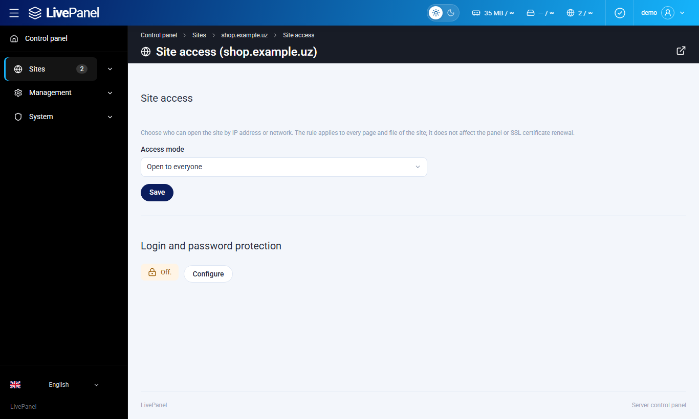
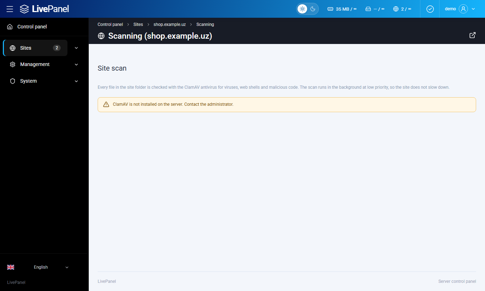

# Sayt xavfsizligi va skanerlash

## Saytga kirish (IP bo‘yicha)

Sayt sahifasidagi **«Saytga kirish»** plitkasi saytni kim ocha olishini IP manzil yoki tarmoq bo‘yicha belgilaydi. Qoida saytning barcha sahifalari va fayllariga qo‘llanadi; panelga va SSL sertifikatini yangilashga ta’sir qilmaydi.

**Kirish rejimi:**

- **Hamma uchun ochiq** — standart.
- **Faqat ro‘yxatdagi manzillarga ruxsat** — ofis yoki ishlab chiqish serverlari uchun. Ro‘yxatda bo‘lmagan har kim «403 Forbidden» ko‘radi — o‘z IP manzilingizni ham qo‘shishni unutmang.
- **Ro‘yxatdagi manzillarni bloklash** — muammo tug‘dirayotgan botlar va hujumchilar uchun.

Ro‘yxatga har qatorga bitta IP (`203.0.113.7`) yoki tarmoq (`198.51.100.0/24`) yoziladi; IPv6 ham bo‘ladi.

> Sayt Cloudflare kabi proxy orqali ishlasa, Nginx tashrifchining emas, proxy’ning IP manzilini ko‘radi — bu holda qoida kutilganidek ishlamaydi.

Shu sahifada **login va parol bilan himoya** holati ham ko‘rinadi; **«Sozlash»** uni sayt sozlamalarida ochadi ([Sayt sozlamalari](site-settings.md) → HTTP avtorizatsiya).

## Skanerlash (antivirus)

**«Skanerlash»** plitkasi sayt papkasidagi barcha fayllarni **ClamAV** antivirusi bilan viruslar, web-shell va zararli kodga tekshiradi. Skanerlash fonda, past ustuvorlikda ishlaydi — sayt sekinlashmaydi.

ClamAV serverda o‘rnatilgan bo‘lishi kerak: administrator uni **Tizim → Ilovalar** → `clamav` dan o‘rnatadi. Virus bazasi ~300 MB yuklanadi, skanerlash paytida ~1 GB RAM ishlatiladi.

1. **«Skanerlash»** tugmasini bosing. Sayt hajmiga qarab bir necha daqiqa davom etadi.
2. Natija: **«Tahdid topilmadi»** yoki **«N ta shubhali fayl topildi»** — fayl yo‘li va tahdid nomi bilan.
3. Har bir topilgan fayl uchun:
   - **Karantinga** — fayl saytdan olib qo‘yiladi va ishlamaydi; xato bilan olingan bo‘lsa **Tiklash** mumkin;
   - **Butunlay o‘chirish**.

Sayt buzilgan bo‘lsa: zararli fayllarni olib tashlang, CMS va plaginlarni yangilang, barcha parollarni (panel, FTP, baza, CMS administratori) almashtiring.

## Boshqa himoya choralari

- Saytga so‘rovlar chegarasi — [Sayt sozlamalari](site-settings.md) → Xavfsizlik.
- Server darajasidagi firewall — [Firewall](firewall.md).
- Panel, SSH, FTP va pochtaga parol tanlash hujumlaridan himoya — [Panel sozlamalari va xavfsizlik](panel-settings.md).
