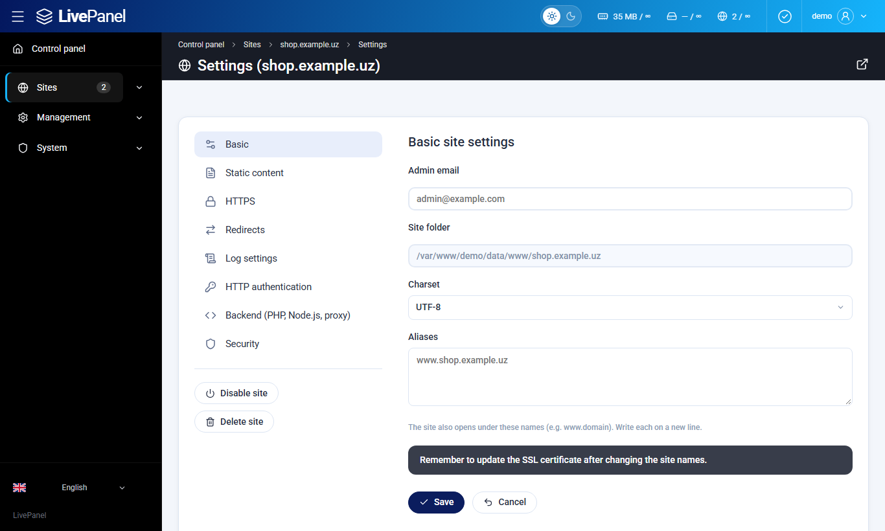
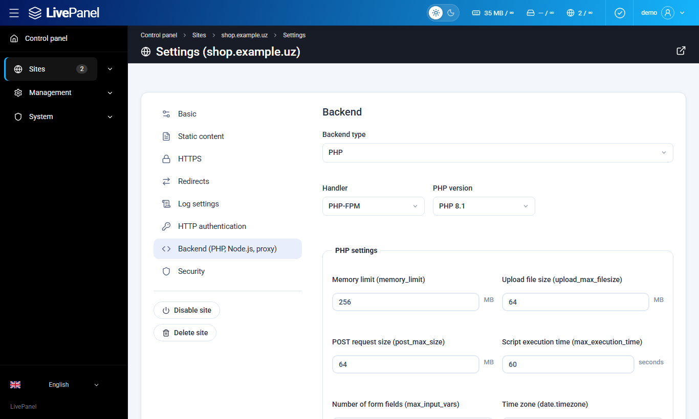

# Sayt sozlamalari

Sayt sahifasidagi **«Sozlamalar»** plitkasi saytning Nginx, backend va xavfsizlik sozlamalarini ochadi. Chap tomonda bo‘limlar, o‘ngda ularning maydonlari turadi. O‘zgarishlar **«Saqlash»** tugmasi bilan qo‘llanadi: panel avval Nginx sozlamasini tekshiradi, xato bo‘lsa eski holatga qaytaradi — sayt to‘xtab qolmaydi.

## Asosiy

- **Admin email** — sayt administratorining emaili (ba’zi xato sahifalarida ko‘rsatiladi).
- **Sayt papkasi** — saytning fayllari joylashgan papka.
- **Kodlash (charset)** — Nginx yuboradigan kodlash, odatda UTF-8.
- **Aliaslar** — sayt shu nomlar bilan ham ochiladi (masalan `www.example.uz`). Har birini yangi qatorga yozing. Aliaslar o‘zgarsa, SSL sertifikatini qayta oling.

## Statik kontent

- **Gzip siqishni yoqish** va **Gzip darajasi** — sahifalarni siqib yuborish; 5-daraja tavsiya etiladi.
- **Statik fayllarni Nginx bersin** — rasmlar, CSS, JS kabi fayllarni PHP/ilovaga yubormasdan Nginx o‘zi beradi (tezroq).
- **Statik fayl kengaytmalari** va **Kesh muddati (kun)** — brauzer bu fayllarni qancha kun keshda saqlashi.

## HTTPS

- **HTTPS’ga yo‘naltirish** — barcha HTTP so‘rovlar HTTPS’ga yo‘naltiriladi.
- **HSTS’ni yoqish** — brauzerga saytni faqat HTTPS orqali ochishni buyuradi.
- **HTTP/2 ni yoqish**.

Bu sozlamalar uchun avval SSL sertifikat kerak — [SSL sertifikatlar](ssl.md).

## Yo‘naltirishlar

Ma’lum manzil ochilganda tashrifchini boshqa sahifaga yuborish: **Qaysi manzildan**, **Qayerga** va **Kod** (301 — doimiy, 302 — vaqtincha). Masalan `/old-page` → `/new-page`.

## Log sozlamalari

**Kirishlar logi** va **Xatolar logi**ni yoqish yoki o‘chirish. Kirishlar logi o‘chirilsa, trafik va tashriflar statistikasi hisoblanmaydi — [Statistika va trafik](statistics.md).

## HTTP avtorizatsiya

**Saytni login va parol bilan yopish** — sayt ochilganda brauzer login va parol so‘raydi. Sinovdagi yoki ichki saytlar uchun qulay.

## Backend

**Backend turi** — sayt nimada ishlashi: PHP, Node.js, Python, statik sayt yoki reverse proxy. Turni saytni qayta yaratmasdan almashtirish mumkin:

- sayt fayllari o‘chmaydi;
- avval yangi backend sozlanadi va ishga tushiriladi, keyin eski xizmat (PHP pool yoki ilova xizmati) to‘xtatiladi;
- Node.js uchun `app.js`, Python uchun `app.py` va `gunicorn.conf.py` bo‘lmasa, boshlang‘ich fayllar yaratiladi;
- biror qadam xato bersa, sayt avvalgi backendda qoladi.

Turga qarab maydonlar:

- **PHP** — ishlov beruvchi (PHP-FPM, FastCGI, Apache module, CGI), PHP versiyasi va **PHP sozlamalari**: `memory_limit`, `upload_max_filesize`, `post_max_size`, `max_execution_time`, `max_input_vars`, vaqt mintaqasi, `display_errors`.
- **Node.js** — Node.js versiyasi va **muhit o‘zgaruvchilari**.
- **Python** — Python versiyasi va muhit o‘zgaruvchilari. Versiya o‘zgarsa, `.venv` yangi versiya bilan qayta yaratiladi — [Python va Node.js saytlar](python-nodejs.md).
- **Reverse proxy** — so‘rovlar uzatiladigan manzil, masalan `http://127.0.0.1:3000`.

| PHP ishlov beruvchisi | Xususiyati |
|---|---|
| PHP-FPM | Har sayt uchun alohida pool, sayt egasi nomidan. Ko‘p hollarda eng yaxshi tanlov |
| FastCGI | Saytga alohida php-cgi jarayoni |
| Apache module | Apache mod_php orqali (mpm-itk), `.htaccess` ishlaydi. Faqat tizim PHP versiyasi |
| CGI | Har so‘rovda php-cgi ishga tushadi. Sekinroq, eski ilovalar uchun |

## Xavfsizlik

- **So‘rovlar chegarasi** — bitta IP’dan soniyada yoki daqiqada nechta so‘rov qabul qilinishi (DDoS va botlardan himoya).
- **Burst** — qisqa vaqtli ko‘p so‘rovlarga ruxsat va ularni kechiktirmaslik.

Saytga kirishni IP bo‘yicha cheklash — [Sayt xavfsizligi va skanerlash](site-security.md).
