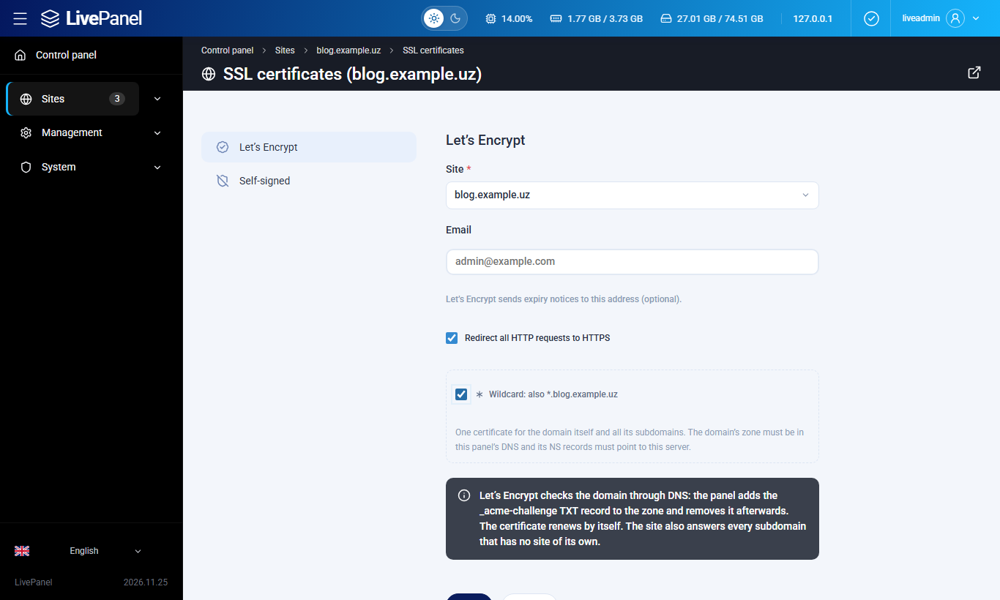

# SSL sertifikatlar

SSL sertifikat sayt bilan brauzer orasidagi trafikni shifrlaydi va sayt `https://` orqali ochiladi. Panel **Let’s Encrypt**’dan bepul sertifikatni bir bosishda oladi va muddatidan oldin avtomatik yangilaydi.


## Sertifikat olish

1. Domen (va `www` aliasi) **shu server IP manziliga yo‘naltirilgan** bo‘lsin. DNS o‘zgarishi tarqalishi bir necha daqiqadan bir necha soatgacha davom etadi.
2. Sayt sahifasida **«SSL sertifikatlar»** plitkasini oching.
3. **«Yangi sertifikat»** tugmasini bosing.
4. Saytni va turini tanlang:
   - **Let’s Encrypt** — ishonchli, bepul, 90 kunlik; panel uni o‘zi yangilaydi.
   - **O‘z-o‘zidan imzolangan** — trafikni shifrlaydi, lekin brauzer ogohlantiradi. Domeni hali yo‘naltirilmagan sinov saytlari uchun.
5. **Email** ixtiyoriy: Let’s Encrypt muddat bilan bog‘liq muammolar haqida shu manzilga yozadi.
6. **«Barcha HTTP so‘rovlarni HTTPS’ga yo‘naltirish»** ni yoqib qo‘ying.
7. Tasdiqlang. Sertifikat bir necha soniyada o‘rnatiladi.

Sertifikat saytning domeni va barcha aliaslari uchun olinadi.

## Sertifikatlar ro‘yxati

Jadvalda sayt, turi, amal qilish muddati va HTTPS’ga yo‘naltirish holati ko‘rinadi. Satr menyusidan:

- **Qayta chiqarish** — sertifikatni yangidan olish (masalan, alias qo‘shgandan keyin);
- **HTTPS’ga yo‘naltirishni yoqish/o‘chirish**;
- **Sertifikatni o‘chirish** — sayt faqat HTTP orqali ishlaydi.

## Wildcard sertifikat (Premium)



Wildcard sertifikat domenning o‘zi va **barcha subdomenlari** uchun bitta sertifikat: `example.uz` va `*.example.uz`. Bu imkoniyat faqat **Premium** litsenziyali panellarda ishlaydi.

Let’s Encrypt wildcard nomni faqat DNS orqali tekshiradi: `_acme-challenge.<domen>` TXT yozuvi kerak. Panel bu yozuvni o‘zi qo‘yishi uchun ikki yo‘ldan biri yetadi:

1. **Domenning DNS’i shu serverda** — domen zonasi panelda ([Domenlar va DNS](dns.md)) va registratorda NS serverlari shu serverga yo‘naltirilgan (`dig NS example.uz`).
2. **DNS boshqa joyda qoladi** (registrator yoki DNS provayderda) — u yerga **bitta NS yozuvi** qo‘shasiz va faqat tekshiruv nomi shu serverga topshiriladi:

   ```
   _acme-challenge.example.uz.  NS  example.uz.
   ```

   Aniq yozuvni panel o‘zi ko‘rsatadi: wildcard birinchi marta so‘ralganda xato oynasida chiqadi. NS qiymati — shu serverga yo‘naltirilgan nom (odatda domenning o‘zi). Qolgan DNS yozuvlari o‘zgarmaydi. Yozuv qo‘shilgach 5–10 daqiqa kutib, sertifikatni qayta so‘rang.

Olish tartibi: **Yangi sertifikat** → **Let’s Encrypt** → **Wildcard: \*.domen ham** belgisini qo‘ying. Let’s Encrypt domenni DNS orqali tekshiradi. Panel `_acme-challenge` TXT yozuvini zonaga o‘zi qo‘shadi va tekshiruvdan keyin o‘chiradi. Sertifikat avtomatik yangilanadi, yangilanishda ham shu yo‘l ishlatiladi.

Wildcard sertifikatli sayt o‘z sayti bo‘lmagan barcha subdomenlarga ham javob beradi (`server_name` ga `*.domen` qo‘shiladi). O‘z sayti bor subdomenlar avvalgidek o‘z saytini ochadi.

Xatolar:

- **DNS shu serverda emas** — panel ko‘rsatgan NS yozuvini qo‘shing (2-yo‘l) yoki domen NS’ini shu serverga ko‘chiring (1-yo‘l);
- **zona yo‘q** — domen NS’i shu serverda, lekin panelda zonasi yo‘q: **Domenlar va DNS** bo‘limida zonani yarating.

## Avtomatik yangilanish

Let’s Encrypt sertifikatlari muddati tugashidan oldin o‘zi yangilanadi. Muddati 14 kundan kam qolgan va yangilanmagan sertifikat haqida panel sayt egasi va administratorga email yuboradi.

## Sertifikat olinmasa

- **Domen boshqa IP’ga yo‘naltirilgan** — A yozuvini tekshiring: `nslookup example.uz`.
- **80-port yopiq** — Let’s Encrypt tekshiruvi 80-port orqali o‘tadi. Firewall’da HTTP qoidasi turishi kerak — [Firewall](firewall.md).
- **Cloudflare proxy (to‘q sariq bulut)** yoqilgan — vaqtincha o‘chiring yoki Cloudflare’da SSL rejimini «Full» qiling.
- **Juda ko‘p urinish** — Let’s Encrypt bir domen uchun urinishlarni cheklaydi; bir soatdan keyin qayta urining.

Panelning o‘zi uchun SSL — [Panel manzili va SSL](panel-access.md).
