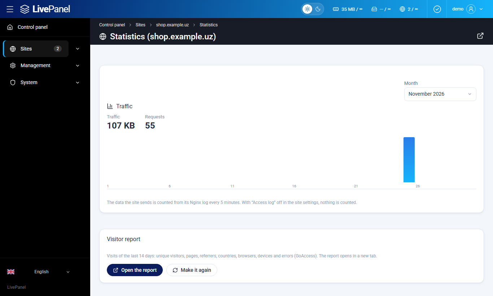
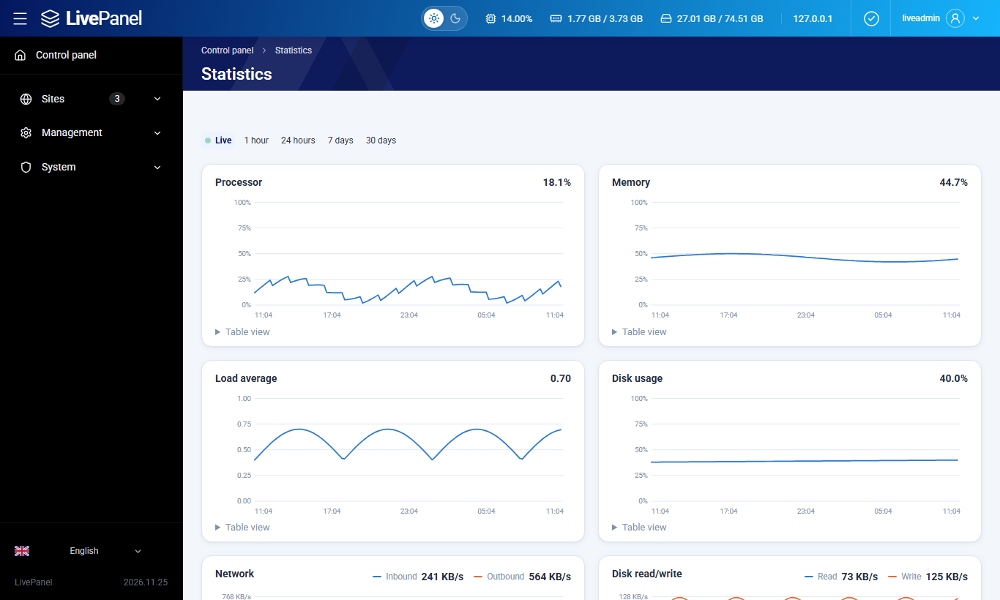

# Statistika va trafik

## Sayt statistikasi

Sayt sahifasidagi **«Statistika»** plitkasida:

- **Trafik** — tanlangan oyda saytdan yuborilgan ma’lumot hajmi va so‘rovlar soni;
- **kunlik grafik** — har bir kun ustunining ustiga borsangiz, sana, hajm va so‘rovlar soni chiqadi;
- **Oy** tanlovi — joriy va oldingi 11 oy.

Trafik saytning Nginx kirishlar logidan har 5 daqiqada hisoblanadi va 400 kun saqlanadi. Sayt sozlamalarida **kirishlar logi** o‘chirilgan bo‘lsa, trafik hisoblanmaydi.

### Tashriflar hisoboti

**«Hisobotni ochish»** tugmasi oxirgi 14 kunlik tashriflar bo‘yicha batafsil hisobotni (GoAccess) yangi oynada ochadi:

- noyob tashrif buyuruvchilar va so‘rovlar kunlar bo‘yicha;
- eng ko‘p ochilgan sahifalar va fayllar, topilmagan sahifalar (404);
- tashrifchilar qayerdan kelgani (manbalar), mamlakatlar;
- brauzerlar, operatsion tizimlar, qurilmalar va botlar;
- javob kodlari va eng ko‘p trafik olgan fayllar.

Hisobot 10 daqiqa keshlanadi; **«Yangidan tuzish»** uni darhol qayta tuzadi. Tashrifchilar IP manzili hisobotda anonimlashtiriladi.

## Server statistikasi

**Tizim → Statistika** (administrator uchun) server yuklamasini grafiklarda ko‘rsatadi:

- protsessor, tezkor xotira, disk band qilinishi va o‘rtacha yuklama (load average);
- tarmoq (kiruvchi/chiquvchi) va disk o‘qish/yozish tezligi.

Davr: **Jonli** (har 2 soniyada yangilanadi), **1 soat**, **24 soat**, **7 kun**, **30 kun**. Har bir grafikni jadval ko‘rinishida ham ochish mumkin.

## Akkauntlar va saytlar trafigi

Shu sahifaning pastida **«Trafik: akkauntlar va saytlar»** bo‘limi bor: tanlangan oyda har bir akkaunt (uning barcha saytlari yig‘indisi) va har bir saytning trafigi va so‘rovlari, umumiy kunlik grafik bilan. Mijozlarning qancha trafik ishlatayotganini kuzatish uchun qulay.
