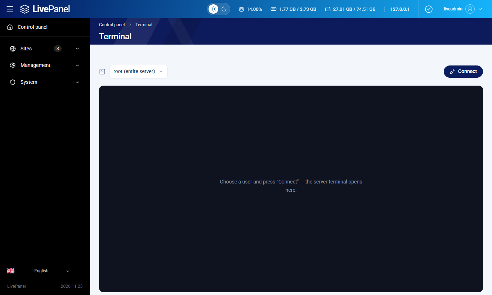

# Terminal

**Tizim → Terminal** server terminalini to‘g‘ridan-to‘g‘ri brauzerda ochadi — SSH dasturi kerak emas.

1. Foydalanuvchini tanlang:
   - **root (butun server)** — faqat administrator uchun; buyruqlar butun serverga ta’sir qiladi;
   - sayt foydalanuvchisi — terminal SSH bilan bir xil himoyalangan muhitda ochiladi: faqat o‘z uy papkasi ko‘rinadi.
2. **«Ulanish»** tugmasini bosing.

Terminalda odatdagi buyruqlar ishlaydi: `ls`, `cd`, `nano`, `git`, `composer`, `npm`, `php`, sayt papkasidagi `.venv/bin/pip` va hokazo. 30 daqiqa harakatsizlikdan keyin sessiya yopiladi; **«Qayta ulanish»** yangi sessiya ochadi.

Oddiy foydalanuvchi terminalni faqat SSH ruxsati bo‘lsa ishlata oladi — administrator uni **Foydalanuvchilar** bo‘limida yoqadi ([Foydalanuvchilar, rollar va limitlar](users.md)).
