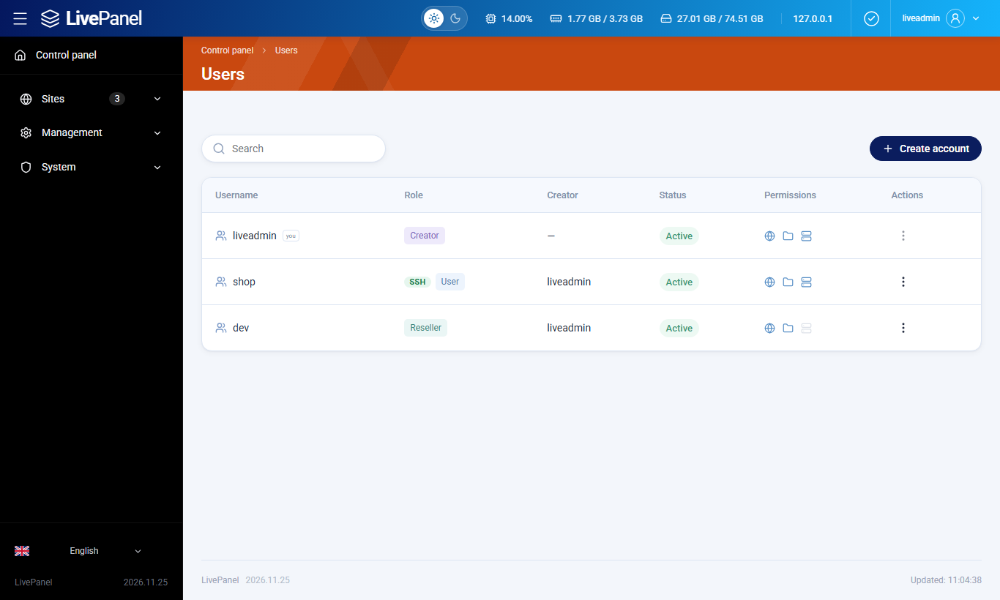
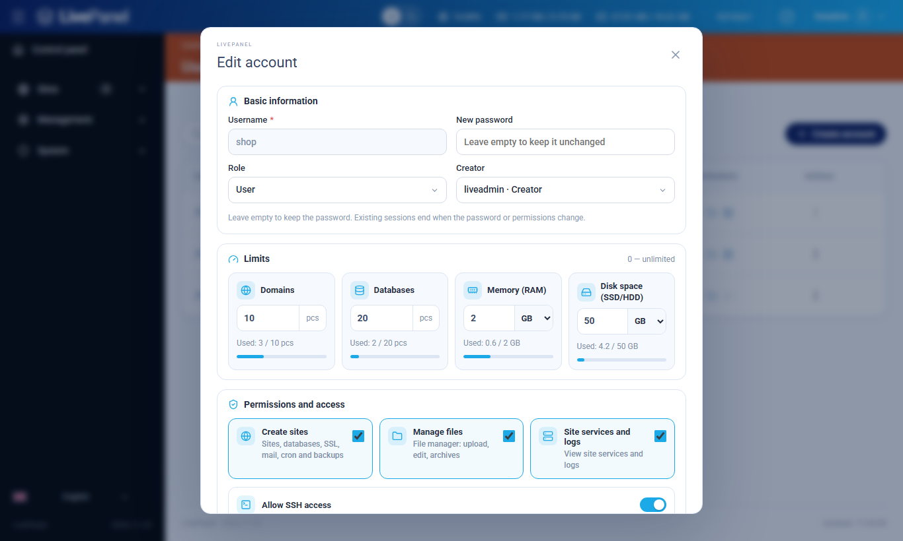

# Foydalanuvchilar, rollar va limitlar

**Tizim → Foydalanuvchilar** bo‘limida panel akkauntlari yaratiladi va boshqariladi. Har bir mijozga alohida akkaunt bersangiz, u faqat o‘z saytlarini ko‘radi va boshqaradi.

## Rollar

| Rol | Imkoniyatlari |
|---|---|
| **Creator** | Panelni o‘rnatgan asosiy administrator (`liveadmin`). Hamma narsaga kirish; o‘chirib bo‘lmaydi |
| **Admin** | Butun server va barcha akkauntlarni boshqaradi |
| **Reseller** | O‘zi yaratgan foydalanuvchilarni boshqaradi, ularga limit beradi; o‘z brendini qo‘ya oladi |
| **Foydalanuvchi** | Faqat o‘z saytlari bilan ishlaydi; server sozlamalarini ko‘rmaydi |

## Akkaunt yaratish

1. **«Akkaunt yaratish»** tugmasini bosing.
2. **Asosiy ma’lumotlar**: login, parol, rol va (administrator uchun) qaysi akkauntga bo‘ysunishi.
3. **Cheklovlar** (Pro va Premium tarifda; 0 — cheksiz):

   | Limit | Ma’nosi |
   |---|---|
   | Domenlar | Nechta sayt yaratishi mumkin |
   | Bazalar | Ma’lumotlar bazalari soni |
   | Tezkor xotira (RAM) | Saytlari jami qancha RAM ishlatishi mumkin (kamida 32 MB) |
   | Disk joyi | Saytlar fayllari, yuklamalar va pochta uchun disk |
   | Foydalanuvchilar | Resellerning nechta foydalanuvchi yaratishi |

4. **Ruxsatlar va kirish**:
   - **Sayt yaratish** — sayt, baza, SSL, pochta, cron va zaxira nusxalar;
   - **Fayllarni boshqarish** — fayl menejeri: yuklash, tahrirlash, arxivlar;
   - **Sayt xizmatlari va loglari** — xizmatlar va loglarni ko‘rish;
   - **SSH orqali kirishga ruxsat** — panel paroli bilan SSH/SFTP; foydalanuvchi faqat o‘z papkasini ko‘radi.
5. Saqlang.

## Akkauntni boshqarish

Satr menyusidan: tahrirlash, parolni almashtirish, **2FA ni o‘chirish** (telefonini yo‘qotgan foydalanuvchi uchun) va o‘chirish. **«Akkaunt faol»** kaliti o‘chirilsa, foydalanuvchi panelga kira olmaydi.

## Limitlar qanday ishlaydi

- **Domen va baza** limiti to‘lsa, yangi sayt yoki baza yaratilmaydi.
- **Disk** limiti Linux disk kvotalari orqali ishlaydi. Kvotalar o‘chiq bo‘lsa, panel **«Kvotalarni yoqish»** tugmasini ko‘rsatadi (faqat ext4 fayl tizimida; `/etc/fstab` ning eski nusxasi saqlanadi).
- **RAM** limiti: akkaunt saytlari limitning 90% iga yetsa, akkaunt **bloklanadi** va saytlari nofaol qilinadi (fayllar va bazalar joyida qoladi). Ro‘yxatda «RAM blok» belgisi chiqadi, administratorga email yuboriladi. Blokni ochish uchun akkauntni tahrirlab **«Akkaunt faol»** ni yoqing va saqlang — saytlar qayta yoqiladi.

Yuqori panelda foydalanuvchi o‘z limitlari va ishlatilganini ko‘rib turadi.

## Resellerlar va brending

Reseller o‘zi yaratgan foydalanuvchilarga o‘z limitlari doirasida limit beradi. **Sozlamalar → Brending** bo‘limida reseller panel nomi, logotipi va rangini o‘rnatadi — uning mijozlari panelni shu brend bilan ko‘radi ([Panel sozlamalari va xavfsizlik](panel-settings.md)).
